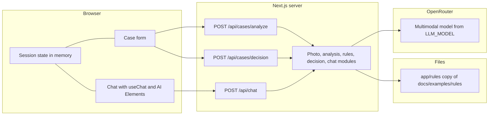
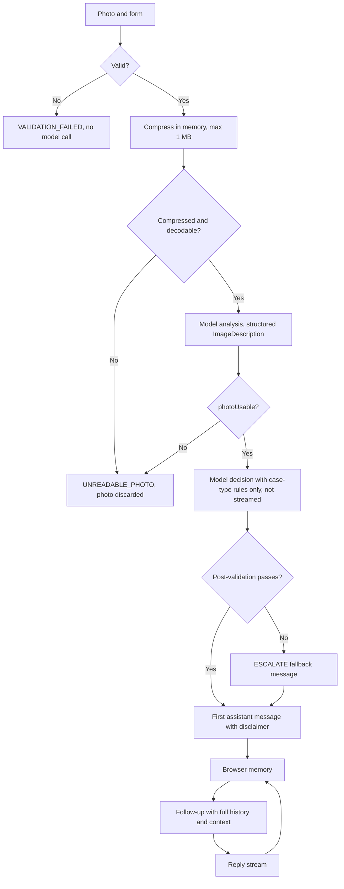
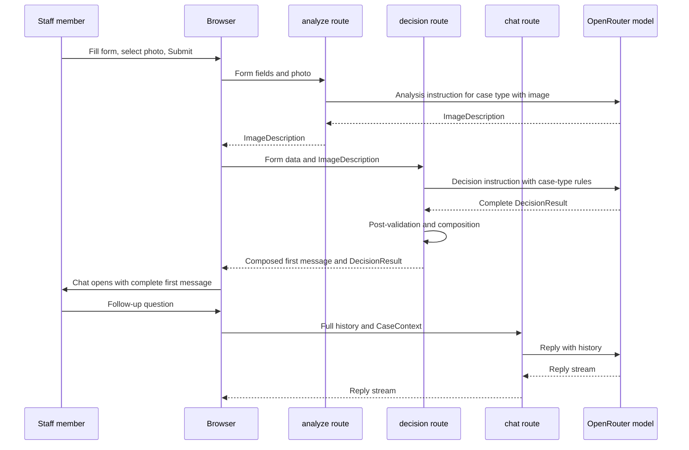
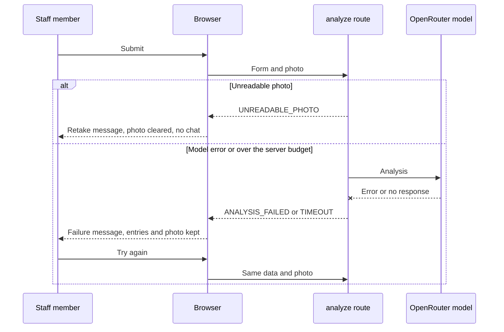

# ADR: Hardware Service Decision Copilot — Main Architecture

**Date:** 2026-10-21
**Status:** Accepted (open items listed in section 11; revised 2026-10-21, see Revision log)
**PRD:** `docs/PRD.md` (binding copy, created 2026-10-21 from `docs/examples/hardware-service-prd.md`, OI-000-7 closed; the two files are identical at creation)

---

## 1. Overview

Hardware Service Decision Copilot is a browser web application for customer support and hardware service staff. Staff submit a complaint or return case with a form and one photo. The server runs two model steps: an image analysis that returns a structured description of the photo, and a decision step that applies the rule document for the selected case type. The result opens a chat where staff read a justified first recommendation and ask follow-up questions.

This ADR set defines how the PRD is built: framework, AI layer, streaming, multimodal input, API boundaries, UI components, data shapes, environment variables, and the test strategy. It does not restate the PRD's business acceptance criteria. Each technical decision names the PRD acceptance criteria (AC-xx) it must satisfy.

The application is advisory. It stores nothing server-side: no database, no sessions, no photo storage (PRD AC-31, AC-35, section 7).

---

## 2. Technology Documentation References

Context7 IDs were verified in this research session. Where no Context7 ID was found, the official documentation link is recorded instead.

| Library | Context7 ID or official docs | Used for |
|---|---|---|
| Vercel AI SDK (`ai` 7.0.15, `@ai-sdk/react` 4.0.16, pinned in `app/package.json`) | `/vercel/ai` (High reputation, 10189 snippets); docs site index `/websites/ai-sdk_dev` | `streamText`, `generateText` with `Output.object`, UI message streams, `useChat`, `DefaultChatTransport`, `convertToModelMessages` |
| Next.js 16.2.10 (App Router) | `/vercel/next.js`; docs index `/websites/nextjs` | Route handlers, streaming responses, `maxDuration`, output file tracing |
| OpenRouter provider for AI SDK (`@openrouter/ai-sdk-provider` 3.1.0, peer `ai` ^7; not installed yet) | No Context7 ID found. Official docs: https://openrouter.ai/docs/guides/community/vercel-ai-sdk | Model access through `createOpenRouter` |
| OpenRouter API | No Context7 ID found. Official docs: https://openrouter.ai/docs | Chat Completions endpoint, image input, model catalogue |
| OpenRouter Responses API (evaluated, not adopted) | No Context7 ID found. https://openrouter.ai/docs/api_reference/responses/overview | Evaluated in ADR-002 |
| AI Elements (Vercel) | No Context7 ID found. Official docs: https://vercel.com/blog/introducing-ai-elements and https://elements.ai-sdk.dev | Chat UI components copied into the repo (ADR-004) |
| assistant-ui | No Context7 ID found. Official docs: https://www.assistant-ui.com/docs/integrations/frameworks/ai-sdk | Evaluated alternative chat UI (ADR-004) |
| Zod | No Context7 ID verified. Official docs: https://zod.dev | Runtime validation of request bodies and model output |
| Vitest and Testing Library | No Context7 ID verified. Official docs: https://vitest.dev | Unit and integration tests. Not in `app/package.json` yet; added as a follow-up (ADR-005 section 7) |
| Playwright (`@playwright/test` ^1.61.1, from the template) | No Context7 ID verified. Official docs: https://playwright.dev | End-to-end tests and manual QA |
| pnpm 10.32.1 | `packageManager` field in `app/package.json` | Package manager (ADR-005) |
| Ultracite (Biome) | `ultracite` ^7.8.4 in `app/package.json` | Lint and format (`pnpm check`, `pnpm fix`) |

Implementing agents must re-check the current docs with Context7 before writing code against any library above. The AI SDK pair is fixed by the template: `ai` 7.0.15 with `@ai-sdk/react` 4.0.16, and `@openrouter/ai-sdk-provider` 3.1.0 declares `ai` ^7 as its peer (checked 2026-10-21, ADR-005).

---

## 3. System Architecture

### Architecture pattern

Single Next.js application with a browser client and server route handlers in one deployable unit. The server is stateless: each request carries everything it needs. The client holds session state in memory only. This is a single-page flow with a thin server layer, not microservices.

### Repository structure

The application lives in `app/`, which is the Next.js project root. It was started from the `vercel/chatbot` template (ADR-005; ADR-001 is superseded). The template is in `app/` but not yet reworked for the PRD.

Planned layout, conceptual:

- `app/app/` — Next.js App Router: pages and route handlers (for example `app/app/(chat)/api/chat/route.ts`).
- `app/lib/` — server modules: case validation, photo compression, prompt construction by case type, rule document loader, decision post-validation, `llm-client`.
- `app/components/ai-elements/` — AI Elements chat components shipped with the template (ADR-004).
- `app/rules/` — committed copy of the rule documents read at runtime by the rule loader (ADR-002 section 6).
- `docs/examples/rules/` — source of the placeholder rule documents (`complaint-rules.md`, `return-rules.md`).
- `docs/PRD.md`, `docs/ADR/` — specification.
- `assets/`, `docs/design-guidelines.md` — brand reference for Manual QA (AGENTS.md).

### Technology stack

| Layer | Technology | Reason |
|---|---|---|
| Framework | Next.js 16.2.10, App Router, TypeScript strict mode | Course requirement; route handlers support streaming; provided by the template (ADR-005) |
| Language | TypeScript with `strict: true` | Course requirement; validation rules in the PRD are easier to enforce with types (ADR-003) |
| Styling | Tailwind CSS 4 (from the template), tokens from `docs/design-guidelines.md` | Matches the AI Elements requirement for Tailwind CSS variables (ADR-004) |
| UI components | AI Elements (shadcn/ui based) and shadcn/ui primitives | Ready streaming chat components that work directly with `useChat` (ADR-004) |
| AI client library | Vercel AI SDK (`ai`) + `@ai-sdk/react` | Unified `streamText`, `generateText` with structured output, `useChat` (ADR-002) |
| LLM gateway | OpenRouter via `@openrouter/ai-sdk-provider` | Course-selected provider; `.env.example` defines `OPENROUTER_API_KEY` and `LLM_MODEL` (ADR-002) |
| Model | One multimodal model, selected by `LLM_MODEL` | Decision 2026-10-21: one model for analysis and decision (ADR-002) |
| Validation | Zod schemas | Request bodies, structured model output, field rules from AC-01 to AC-11 (ADR-003) |
| Image compression | Server-side image library, chosen during implementation (verify with Context7) | AC-11 requires server-side compression to at most 1 MB with the longest side at least 1024 px (ADR-003) |
| Database | None | PRD section 7: no persistence (AC-31) |
| Auth | None | PRD section 7: no login or roles |
| Testing | Vitest with Testing Library (unit, integration; to be added) and Playwright (E2E, manual QA) | Decision 2026-10-21 (section 10) |
| Package manager and lint | pnpm 10.32.1; Ultracite (Biome) | Template defaults (ADR-005) |
| Hosting | Local development and Vercel | Decision 2026-10-21 (section 9) |

---

## 4. Module Structure & Dependencies

Dependency direction is strictly downward: UI components depend on client hooks; client hooks depend on the HTTP contracts; route handlers depend on server modules; server modules depend on the AI SDK and OpenRouter provider. Nothing depends back up. No circular dependencies.

| Module | Responsibility | Depends on | Depended on by |
|---|---|---|---|
| `case-form` (client) | Renders the form, runs field validation (AC-01 to AC-08), submits the case | Shared case schema, `analyze` endpoint | Case page |
| `case-session` (client) | Holds in-memory session: form values, image description, decision, chat messages (AC-30, AC-31) | `useChat` hook, decision endpoint | Case page, chat screen |
| `chat-screen` (client) | Chat list, input, retry, new-case confirmation (AC-23 to AC-29, AC-32) | AI Elements components, `useChat`, `/api/chat` | Case page |
| `shared-schema` | Zod schemas for case form, image description, decision result, error codes; used by client and server | Zod | All modules |
| `photo-preparation` (server) | Validates file type and size, compresses the photo, detects unreadable photos (AC-09 to AC-11) | Image library | `analyze` route |
| `analysis` (server) | Builds the analysis call for the case type, validates the structured description (AC-12 to AC-14) | AI SDK, OpenRouter provider, `shared-schema` | `analyze` route |
| `rules` (server) | Loads the rule document for one case type only from `app/rules/` (AC-14, AC-16) | File system (rule documents) | `decision` route, `chat` route |
| `decision` (server) | Builds the decision call (non-streaming), applies post-validation and composes decision messages (AC-17 to AC-22); also validates `reviseDecision` tool input from chat | AI SDK, `rules`, `shared-schema` | `decision` route, `chat` module |
| `chat` (server) | Answers follow-ups with full history and case context rebuilt from the validated CaseContext; handles `reviseDecision` (AC-27, AC-28) | AI SDK, `rules`, `decision`, `shared-schema` | `chat` route |
| `llm-client` (server) | Single place that creates the OpenRouter provider and reads `LLM_MODEL` and `OPENROUTER_API_KEY` | `@openrouter/ai-sdk-provider` | `analysis`, `decision`, `chat` |

Only `llm-client` reads secrets. Client bundles never import `llm-client`, `rules`, or the image library. This is enforced with the `server-only` marker on those modules.

---

## 5. Data Models

All models are conceptual. Exact validation constraints come from the PRD and are repeated here so the implementing agent does not need to reread them for every field.

### CaseForm
- **Purpose:** The staff input for one case. Lives only in the browser (AC-31).
- **Fields:**
  - `caseType`: one of `complaint`, `return` (AC-01).
  - `equipmentCategory`: one of Laptop, Smartphone, Tablet, Smartwatch, Headphones, Speaker, Monitor, Desktop computer, Printer, Other electronics (AC-02).
  - `modelName`: text, 2 to 100 characters (AC-03).
  - `purchaseDate`: calendar date, not later than today's date in the `Europe/Warsaw` time zone, on both client and server (AC-04).
  - `reason`: text. Required and 10 to 2000 characters for `complaint` (AC-05). Optional and up to 2000 characters for `return` (AC-06).
  - `photo`: exactly one file, JPG, PNG or WEBP, up to 10 MB before compression (AC-07, AC-09, AC-10).
- **Relationships:** One CaseForm produces at most one ImageDescription, one DecisionResult and one chat session.

### ImageDescription
- **Purpose:** Structured output of the analysis step (AC-12, AC-13). Sent to the decision step and to every chat request. Not the photo itself.
- **Complaint fields:** `damageVisible` (yes, no, unclear), `damageType` (text or unknown), `affectedArea` (text or unknown), `likelyCause` (text or unknown). Every field is present even when the value is unknown (AC-12).
- **Return fields:** `signsOfUse` (yes, no, unclear), `visibleCondition` (text or unknown), `itemComplete` (yes, no, unclear) (AC-13).
- **Photo-usability fields (both case types):** `photoUsable` (yes, no) and `photoIssue` (short Polish reason, empty when `photoUsable` is yes). `photoUsable` = no maps to `UNREADABLE_PHOTO` (PRD section 4.3); the full mapping is in ADR-002 section 3.
- **Outcome-deciding fields:** For complaint, `damageVisible`. For return, `signsOfUse` and `itemComplete`. An `unclear` value in one of these forces ESCALATE (AC-15).
- **Persistence:** Browser memory for the session only.

### DecisionResult
- **Purpose:** Validated content of the first chat message (AC-17 to AC-21).
- **Fields:**
  - `category`: one of ACCEPT, REJECT, ESCALATE (AC-17).
  - `ruleReferences`: list of rule identifiers in the form `R-<number>` that exist in the case-type rule document. At least one unless `category` is ESCALATE (AC-19, ADR-002 section 6).
  - `justification`: text, in Polish.
  - `missingInformation`: list, required and non-empty when `category` is ESCALATE (section 11 of the PRD).
  - `nextSteps`: list of 2 to 5 short items (AC-20).
  - `disclaimer`: fixed text. Not produced by the model (AC-21).
- **Persistence:** Browser memory for the session. The first message is never replaced in history (AC-28).

### ChatMessage
- **Purpose:** One entry in the chat list. Source: role (`user` or `assistant` only), content parts, creation timestamp (AC-29). The timestamp is set by the client when a message is added; AI SDK message metadata is an option for carrying it (ADR-004 section 4).
- **Constraint:** The first message is an `assistant` message with a text part (the composed decision) and a data part (the validated DecisionResult). It is not removable (PRD section 9.5). The `system` role is never used for chat messages, because client-supplied system messages would be an injection vector (ADR-002 section 3). User messages are 1 to 2000 characters, text only (AC-24).

### CaseContext (request payload for chat)
- **Purpose:** What the server needs for every chat request, sent by the client because the server keeps no state (AC-27).
- **Contents:** CaseForm without the photo, ImageDescription, and the first DecisionResult (structured, not free text), plus the latest revised DecisionResult if any. The server validates CaseContext against the shared schema and rebuilds the decision context for the model from it. The full message history is sent as UI messages.

### Error model
- **Error codes** (returned as structured errors to the client): `UNSUPPORTED_FILE_TYPE`, `FILE_TOO_LARGE`, `VALIDATION_FAILED`, `UNREADABLE_PHOTO`, `ANALYSIS_FAILED`, `DECISION_FAILED`, `REPLY_FAILED`, `TIMEOUT`.
- Each code maps to one PRD message (sections 4.3, 4.5, AC-09, AC-10, AC-25); the Polish texts are in PRD section 13. `TIMEOUT` shows the section 4.5 message on the form and the AC-25 message in the chat.

---

## 6. API / Interface Contracts

All endpoints run on the Node.js runtime, not Edge, because image compression needs Node modules (ADR-003). None require authentication (PRD section 7). All responses are JSON except `/api/chat`, which uses the AI SDK UI message stream.

| Endpoint | Method | Input | Output | Errors | Notes |
|---|---|---|---|---|---|
| `/api/cases/analyze` | POST | Multipart form: CaseForm fields and one photo file | JSON: ImageDescription only. No image bytes or prepared-photo data are returned to the client. | `UNSUPPORTED_FILE_TYPE`, `FILE_TOO_LARGE`, `VALIDATION_FAILED`, `UNREADABLE_PHOTO`, `ANALYSIS_FAILED`, `TIMEOUT` | Non-streaming. The model result must match the ImageDescription schema before it is returned. `photoUsable` = no returns `UNREADABLE_PHOTO` (ADR-002 section 3). |
| `/api/cases/decision` | POST | JSON: CaseForm without photo, ImageDescription | JSON: the composed first message text and the validated DecisionResult | `VALIDATION_FAILED`, `DECISION_FAILED`, `TIMEOUT` | Non-streaming (revised 2026-10-21, ADR-002 section 3). Only the rule document for `caseType` is loaded (AC-14, AC-16). Post-validation runs before anything is returned; on failure the response carries the ESCALATE fallback message (AC-22). No partial decision reaches the browser (PRD section 4.5). |
| `/api/chat` | POST | JSON: UI messages (full history), CaseContext | UI message stream with the agent reply | `VALIDATION_FAILED` (for example, message length), `REPLY_FAILED`, `TIMEOUT` | Streaming. Each request includes all previous messages (AC-27). The agent replies in Polish (AC-26). A decision change goes through the `reviseDecision` tool and is validated and composed by the server (AC-21, AC-28; ADR-002 section 3). |

### Input constraints enforced on the server
- Every request is validated against the shared schema before any model call. A failed validation returns `VALIDATION_FAILED` and makes no model call.
- `/api/chat`: the last user message must be 1 to 2000 characters (AC-24). Earlier messages are not re-validated for length.
- Request body size: see section 9 (Vercel body limit).

### Timeouts
Revised 2026-10-21. The earlier claim that a 30-second model limit keeps compression plus the model call within 30 seconds was wrong: the two add up.
- **Binding limit (client):** the browser treats any single request (analyze, decision or one chat reply) that does not complete within 30 seconds of being sent as failed, aborts it, and shows the matching message (PRD section 4.5, section 8, AC-25).
- **Server budget (shorter):** each route finishes or fails within 25 seconds from receiving the request, so the server answers with a proper error code before the client limit and network time run out. For analyze, compression has its own budget (proposed 5 seconds) and the model call receives the remainder. Exact values are set in ADR-003 section 3 and checked with a fake clock in tests.
- Route `maxDuration` stays above both limits (the template sets 60 seconds on the chat route; OI-000-6).

---

## 7. Environment Variables

| Variable | Purpose | Required | Example value |
|---|---|---|---|
| `OPENROUTER_API_KEY` | Authenticates requests to OpenRouter. Read only on the server. | Yes | Placeholder; never committed |
| `LLM_MODEL` | OpenRouter model identifier for analysis, decision and chat. Must meet the capability list in ADR-002 section 4 (image input, structured output, streaming, tool calling, Polish). | Yes | Set during implementation after verification against the OpenRouter model catalogue |
| `ANTHROPIC_API_KEY` | Not used. Present only in the repository-root `.env.example` for the other course provider option. | No | Leave empty |

Rules (revised 2026-10-21):
- `app/.env.example` is the application's template file. It lists only `OPENROUTER_API_KEY` and `LLM_MODEL` with empty values. The keys from the starter template (Gateway, Auth, Blob, Postgres, Redis) are commented out there and are deleted together with the template code that reads them (ADR-005).
- The real secrets file is `app/.env.local`, because `app/` is the Next.js project root and Next.js and the Playwright config read `.env.local` from there. It is git-ignored by `app/.gitignore` and by the root `.gitignore` (`.env.*`). It is never committed.
- On Vercel the same two variables are set in the project environment settings.
- Only `OPENROUTER_API_KEY` and `LLM_MODEL` are read by the application after the rework.

---

## 8. Technical Decisions

### Framework: Next.js App Router with TypeScript strict
**Status:** Accepted
**Date:** 2026-10-21
**Context:** The course requires Next.js App Router and TypeScript strict mode. The app streams model output to the browser and needs server-side secrets and image processing.
**Decision:** Use Next.js App Router. Route handlers implement the three endpoints. Pages and components are client or server components as described in ADR-004. TypeScript runs with `strict: true`.
**Rejected alternatives:**
- Pages Router: App Router route handlers are the documented path for streaming responses in the Vercel AI SDK guides.
- Separate backend (Express or Fastify) plus SPA: adds a second deployable and CORS configuration for a single-page MVP.
**Consequences:**
- (+) One deployable; secrets stay on the server.
- (-) Node runtime constraints apply to image compression (ADR-003).
**Review trigger:** If the app must run on Edge only, or if a separate backend team owns the AI service.

### AI SDK and OpenRouter provider
**Status:** Accepted
**Date:** 2026-10-21
**Context:** The course selects OpenRouter (`.env.example`). The app needs streaming chat, a `useChat` client hook, and structured model output for the analysis and decision steps.
**Decision:** Use the Vercel AI SDK (`ai` 7.0.15 and `@ai-sdk/react` 4.0.16, pinned by the template in `app/package.json`) with the OpenRouter provider `@openrouter/ai-sdk-provider` 3.1.0, whose peer dependency is `ai` ^7 (not installed yet). Model calls go through the AI SDK's language model interface with the model id from `LLM_MODEL`.
**Rejected alternatives:**
- Raw OpenRouter HTTP calls: duplicate streaming and `useChat` plumbing that the AI SDK already provides.
- OpenRouter Responses API directly: see the options evaluation below (section 12).
- Anthropic SDK directly: not the provider chosen for this course.
**Consequences:**
- (+) Same code path for streaming, tool-less structured output and the client hook.
- (-) Image input through the OpenRouter provider is not shown in the provider's documentation page; it must be verified by a capture spike before the analysis endpoint is built (ADR-002, section 9).
**Review trigger:** If the OpenRouter provider drops image file parts or structured output for the chosen model.

### Single multimodal model for analysis and decision
**Status:** Accepted
**Date:** 2026-10-21
**Context:** The user chose one multimodal model over a cheap-vision-plus-strong-reasoning split.
**Decision:** One model id in `LLM_MODEL` serves both the analysis step and the decision and chat steps.
**Rejected alternatives:**
- Two models in two variables: lower cost potential, but two configurations and two failure points for a MVP.
**Consequences:**
- (+) One configuration value and one place to verify capabilities.
- (-) Cost and latency are not separately tunable.
**Review trigger:** If analysis latency consistently exceeds the 30-second limit while decision quality is acceptable.

### Stateless server; session in browser memory
**Status:** Accepted
**Date:** 2026-10-21
**Context:** PRD AC-31 and section 7 forbid server-side persistence. AC-27 requires every chat request to include the full history and case context.
**Decision:** Routes keep no state. The client keeps the session in React state (not localStorage, so reloading ends the session as AC-31 requires). Each chat request resends the messages and CaseContext.
**Rejected alternatives:**
- Server-side session store keyed by a cookie: violates section 7 and AC-31.
- localStorage for the session: survives reloads, violating AC-31.
**Consequences:**
- (+) Simple, no database, nothing to purge (AC-35).
- (-) Request payloads grow with the conversation; the 2000-character message limit and the single decision keep this small in practice.
**Review trigger:** If the PRD adds session persistence (PRD section 12, open questions).

### Photo handling: compression on the server, no storage
**Status:** Accepted
**Date:** 2026-10-21
**Context:** AC-11 requires server-side compression to at most 1 MB with the longest side at least 1024 px. AC-35 forbids storing the photo.
**Decision:** The analyze route receives the photo in the multipart request, compresses it in memory, sends it to the model, and discards it when the request ends. No file is written to disk. Details are in ADR-003, section 3.
**Rejected alternatives:**
- Client-side compression as the only step: the PRD states the backend compresses (AC-11).
- Writing the photo to temporary disk: violates the spirit of AC-35 and is unnecessary.
**Consequences:**
- (+) The photo exists only for the duration of one request.
- (-) Request size limits on the hosting platform constrain upload size. See section 9.
**Review trigger:** If the platform body limit blocks 10 MB photos (OI-000-1).

### Chat UI: AI Elements on shadcn/ui
**Status:** Accepted
**Date:** 2026-10-21
**Context:** The chat needs streaming messages, a message list and an input, and must integrate with `useChat`. Details in ADR-004.
**Decision:** Use AI Elements components copied into the repository, built on shadcn/ui.
**Rejected alternatives:**
- assistant-ui: a runtime layer on top of `useChat` with several package versions in flight; more power than this MVP needs. Kept as the fallback.
- chat-sdk.dev template: see section 12.
**Consequences:**
- (+) Components are source files in the repo and can be changed to meet the Polish text and design requirements.
- (-) Default English labels must be overridden to satisfy AC-33.
**Review trigger:** If AI Elements lacks a component needed for the first-message layout (section 9.5 of the PRD).

### Rule documents read by the server only
**Status:** Accepted
**Date:** 2026-10-21
**Context:** PRD section 8 names two placeholder rule documents. AC-14 and AC-16 forbid one case type from using the other's rules.
**Decision:** The rules module reads the file for the requested case type only. The file path is fixed by case type, not by user input, to avoid path injection. The source placeholders stay in `docs/examples/rules/` (the user chose to use them as placeholders). Because the deployed project root is `app/`, a committed copy in `app/rules/` is what the server reads; a sync script creates it, a unit test fails on drift, and `outputFileTracingIncludes` in `app/next.config.ts` adds `rules/*.md` to the route bundles. A test checks that the built and deployed bundle contains both files (ADR-002 section 6, TAC-002-07).
**Rejected alternatives:**
- Both rule documents in every prompt: violates AC-16.
- Rules embedded as strings in code: harder for the company to replace the texts (PRD section 8 says they will be replaced).
**Consequences:**
- (+) The company replaces texts without code changes.
- (-) A runtime file read must be verified on the deployment target.
- (-) Two copies of each rule file exist; the drift test keeps them equal.
**Review trigger:** If the company's approved texts are provided in another format.

### Testing: Vitest and Playwright
**Status:** Accepted
**Date:** 2026-10-21
**Context:** The user chose Vitest with Playwright. AGENTS.md requires unit tests with mocks, integration tests that mock only the external LLM API, and E2E with no mocks.
**Decision:** Vitest with Testing Library for unit and integration (to be added to `app/package.json`; the template has neither). Playwright for E2E and manual QA. The template's mock-model path for Playwright is removed, so E2E runs against the real OpenRouter key (ADR-005 section 4). Section 10 defines the layers.
**Rejected alternatives:**
- Playwright only: weaker coverage of validation and post-validation rules.
**Consequences:**
- (+) Fast feedback for validation rules; real-stack E2E for flows.
- (-) E2E needs a real OpenRouter key and costs model calls.
**Review trigger:** If E2E runs become too slow or costly for every commit.

### Deployment: local development and Vercel
**Status:** Accepted
**Date:** 2026-10-21
**Context:** The user chose local plus Vercel.
**Decision:** Development runs locally with `pnpm dev` in `app/` (script `next dev --turbo`). Production targets Vercel with the project root directory set to `app/`. Secrets are set in Vercel project environment variables, not committed.
**Rejected alternatives:**
- Local only: no shared review URL for stakeholders.
- Docker: adds container configuration with no requirement behind it.
**Consequences:**
- (+) Native fit for Next.js and the AI SDK.
- (-) Vercel body-size and duration limits apply (section 9).
**Review trigger:** If the company needs on-premise hosting.

---

## 9. Deployment and platform constraints

- **Runtime:** Node.js for all route handlers (ADR-003).
- **Request body size:** Vercel functions have a request body limit. The implementing agent must check the current limit in the Vercel documentation before implementation. If the limit is below 10 MB, the browser must reduce the photo size before upload, and the server still applies AC-11 limits. This is recorded as OI-000-1, because it adds client-side resizing that the PRD does not mention.
- **Duration:** Route `maxDuration` is set above the 30-second client limit so the application limits are binding (section 6). The template already sets `maxDuration = 60` in `app/app/(chat)/api/chat/route.ts`; the value is confirmed against the Vercel plan limits (OI-000-6).
- **Rule files:** shipped through the committed `app/rules/` copy and output file tracing (section 8, ADR-002 section 6).
- **Data residency and provider retention:** The photo and the form are sent to OpenRouter and to the model provider behind it. OI-000-2 covers choosing provider settings that avoid retention; the PRD lists it as an open question (PRD section 12).

---

## 10. Testing Strategy

### Philosophy
Tests are written before production code (TDD, AGENTS.md). Validation rules and the case-type isolation rules are testable without a model and must have tests before the endpoints are built. Unit tests mock all dependencies. Integration tests mock only the external LLM API (the OpenRouter provider boundary); everything else, including the image library, the file system and the app's own routes, is real. E2E mocks nothing. Mock responses must come from a fresh capture of the real API with synthetic data (AGENTS.md).

### Test layers

| Layer | Type | Scope | Tools |
|---|---|---|---|
| Unit | Mocks all dependencies | Shared schemas, field rules (AC-01 to AC-08), file type and size checks (AC-09, AC-10), compression decision logic with the image library mocked, prompt selection by case type (AC-14), rule loader by case type with fixture text (AC-16), decision post-validation and composition (AC-17 to AC-22), chat length rules (AC-24), error mapping; React components with Testing Library and a stubbed `fetch` (ADR-004 section 8) | Vitest, Testing Library |
| Integration | Mocks only the OpenRouter/LLM boundary | Route handlers `analyze`, `decision`, `chat` with real Zod validation, real compression with the real image library, real rule files and real stream protocol; file-system checks for "no photo written"; LLM replaced at the provider boundary with captured responses | Vitest, route handler calls |
| E2E | No mocks, real stack and real OpenRouter key | Complaint and return happy paths, unreadable photo, failure paths forced without mocks (ADR-004 section 8), follow-up chat, new-case confirmation, Back navigation, viewport 360 px and 1440 px | Playwright |
| Agent behaviour | No mocks, real model | PRD section 11 scenarios (ADR-002 section 9) | Separate suite, not run on every commit |
| Manual QA | Real running app | Every screen touched, screenshots, comparison with brand reference (AGENTS.md) | Playwright CLI and human review |

### Key test scenarios
Detailed per area in ADR-002 (AI), ADR-003 (backend) and ADR-004 (frontend). The main-architecture scenarios:

- **Happy path, complaint:** Valid form and a clear photo. Expected: analysis returns a complaint description; the loading state stays until the validated decision arrives; chat opens with the complete first message (greeting, bold category in sentence two, at least one rule reference, 2 to 5 next steps, disclaimer) as the first message (AC-18 to AC-23).
- **Happy path, return:** Same with a return case. Expected: the return instruction and the return rules are used, the complaint rules are never loaded (AC-14, AC-16).
- **Unreadable photo:** Dark or unrelated image. Expected: `UNREADABLE_PHOTO`, form values kept, photo field cleared, no decision (section 4.3).
- **Analysis failure and retry:** Model returns an error or exceeds the budget. Expected: failure message, form and photo kept, retry repeats the analysis (section 4.5).
- **Decision failure and retry:** Decision call fails. Expected: failure message, retry repeats only the decision with the stored ImageDescription (section 4.5, ADR-004 section 3).
- **Ambiguous decision:** Analysis returns `unclear` for an outcome-deciding field. Expected: ESCALATE with missing information listed (AC-15, section 4.6).
- **Post-validation failure:** Model output lacks a rule reference. Expected: the server returns ESCALATE with the human-review message (AC-19, AC-22).
- **Follow-up that changes the decision:** A new fact in chat. Expected: a new validated decision message states the new category, the reason, a rule reference or ESCALATE, and the disclaimer; the first message stays unchanged (AC-21, AC-28).
- **Out-of-scope question:** Expected: polite refusal naming what the agent can help with (section 4.4).
- **New case with follow-up messages:** Expected: confirmation dialog, Cancel keeps the chat (AC-32).
- **Reload:** Expected: empty form, no stored data (AC-31).
- **Language:** All UI strings and agent replies are Polish (AC-26, AC-33).

### Technical acceptance criteria

- **TAC-01:** Every endpoint rejects a request that fails the shared schema with `VALIDATION_FAILED` and makes no LLM call (verified by a spy on the provider boundary in integration tests).
- **TAC-02:** For a return case, the prompt sent to the model (decision and chat) never contains text from the complaint rule document, and vice versa (unit test with fixture rule files).
- **TAC-03:** Every composed decision message has the greeting (or change notice) first and the bold category in its first two sentences for every category value (unit test on the composition function).
- **TAC-04:** The server never writes the photo to disk or to any store (integration test that checks the file system and the absence of persistence calls).
- **TAC-05:** Each route answers within the 25-second server budget, including compression for analyze, and the client aborts at 30 seconds (integration test with a delayed provider boundary and a fake clock; unit test on the client abort; E2E measurement recorded in Manual QA).
- **TAC-06:** No secret appears in any client bundle (build output scan for `OPENROUTER_API_KEY` value).
- **TAC-07:** Manual QA is recorded with screenshots for every touched screen before a task is marked done (AGENTS.md).

---

## 11. Open Items

Items the implementing agent resolves or the user confirms. Numbering scheme across the ADR set: `OI-<ADR number>-<n>`. ADR-003 refers to the items below; ADR-002, ADR-004 and ADR-005 keep their own lists.

- **OI-000-1** Platform request body limit for the chosen Vercel plan. Decides whether client-side resizing is needed before a 10 MB photo can reach the server (ADR-003, section 3). Requires the user's approval if the PRD wording must change.
- **OI-000-2** Provider data retention for photos and form data sent to OpenRouter and the upstream model provider. The implementing agent researches the OpenRouter and upstream retention settings and proposes them; the business owner decides which settings are acceptable (PRD R6 makes this a go-live blocker). Until then the app must not be used with real customer data. Also listed as a PRD open question (PRD section 12).
- **OI-000-3** Exact `LLM_MODEL` identifier. Must meet ADR-002 section 4. Not confirmed in this research (OI-002-1).
- **OI-000-4** Image file part through the OpenRouter provider. Confirmed by the capture spike, with a fallback to direct Chat Completions (ADR-002 section 9, OI-002-2).
- **OI-000-5** Image compression library. Chosen during implementation and verified with Context7 (ADR-003).
- **OI-000-6** `maxDuration` per route: the template sets 60 seconds on the chat route; confirm the value against the Vercel plan limits and set it on the two new routes (ADR-003).
- **OI-000-7** Closed 2026-10-21: `docs/PRD.md` is the binding PRD, copied from `docs/examples/hardware-service-prd.md` on the user's instruction. Later PRD changes go to `docs/PRD.md`.

---

## 12. Options Evaluation

The user listed several options. Each was read before the decision was made.

| Option | Source read | Finding | Fit for this PRD | Verdict |
|---|---|---|---|---|
| chat-sdk.dev | https://chat-sdk.dev/ and its docs page | The page describes Chat SDK, a TypeScript SDK for chat bots that run on Slack, Microsoft Teams, Google Chat, Discord, Telegram, WhatsApp and others, with a state adapter (Redis in the examples). It is not a Next.js chat app template. Separately, a web search showed a different Next.js "Chat SDK" template (a Greptile listing and mirror repositories) that uses the Vercel AI Gateway with xAI as default, Neon Postgres and Auth.js. Neither source mentions OpenRouter or image input. | Poor. The PRD excludes authentication, persistence, multiple platforms and integrations (section 7). The template's default stack would need removing, and it routes models through a gateway with a different default than the course provider. | Reject. The user must confirm which product they meant. If the user meant the Next.js template, its stack still conflicts with PRD section 7. |
| OpenRouter Responses API | https://openrouter.ai/docs/api_reference/responses/overview | Stateless endpoint, `model` and `input` fields, OpenAI-compatible. Streaming parameter, image input format and stability status not in the fetched page. | Unproven for this app's streaming and image needs | Not for MVP (ADR-002, section 10) |
| OpenRouter provider for Vercel AI SDK | https://openrouter.ai/docs/guides/community/vercel-ai-sdk | Package `@openrouter/ai-sdk-provider`; `createOpenRouter`; text and streaming examples. Image chat input not shown. | Good; the official route from the AI SDK to OpenRouter | Adopt (ADR-002) |
| Vercel AI SDK (`streamText`, `useChat`) | Context7 `/vercel/ai` | Verified: `useChat` with `DefaultChatTransport`, `convertToModelMessages`, `toUIMessageStream`, `createUIMessageStreamResponse`, image file parts in messages (cookbook), `Output.object` with Zod | Strong | Adopt (ADR-002, ADR-003, ADR-004) |
| AI Elements | Vercel blog and elements documentation (search); `app/components/ai-elements/` in the template | shadcn/ui based; copied into the repository; `MessageResponse` (in `message.tsx`) renders streaming markdown; works with `useChat` | Strong | Adopt (ADR-004) |
| assistant-ui | https://www.assistant-ui.com/docs/integrations/frameworks/ai-sdk (search) | Runtime layer over `useChat` with several package versions and compatibility gaps noted in its docs | Possible but heavier than needed | Fallback (ADR-004) |

### Recommended stack for this PRD

Next.js App Router with TypeScript strict, started from the `vercel/chatbot` template (ADR-005); Vercel AI SDK with the OpenRouter provider; one multimodal model in `LLM_MODEL`; non-streamed structured output for analysis and decision; streaming `streamText` with `useChat` for follow-ups; AI Elements on shadcn/ui; Vitest and Playwright; no database and no authentication.

---

## 13. Diagrams

### 13.1 Architecture / component diagram

### 13.2 Data flow diagram

### 13.3 Sequence diagram: end-to-end decision flow (happy path)

### 13.4 Sequence diagram: error and retry path

---

## Revision log

- **2026-10-21** Documentation review:
  - P1-1: `/api/cases/decision` is non-streaming JSON with a validated, composed message (section 6, diagrams 13.2 and 13.3).
  - P1-2: `photoUsable` and `photoIssue` added to ImageDescription (section 5).
  - P1-3, P2-3: testing decision states the mock-model path is removed and Vitest with Testing Library must be added (sections 2, 3, 8, 10).
  - P2-4: environment variable rules rewritten for `app/.env.example` and `app/.env.local` (section 7).
  - P2-5: rule files shipped through `app/rules/` and output file tracing (sections 3, 8, 9).
  - P3: timeouts corrected (client 30 seconds binding, server budget 25 seconds); assistant role and server-rebuilt context (section 5); `Europe/Warsaw` for AC-04; rule identifier form `R-<number>`.
  - P4: removed "prepared-photo status" from the analyze output; stale ADR-001 and npm references replaced with ADR-005, `pnpm dev` and `app/app/`; versions recorded and the false ADR-002 version reference removed; open items renumbered to OI-000-n; `MessageResponse` named; TAC-02 extended to chat.
