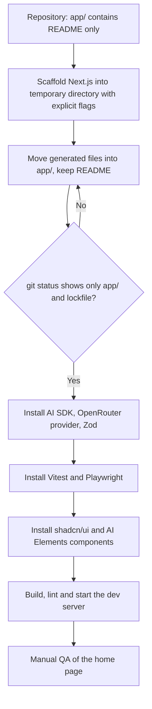
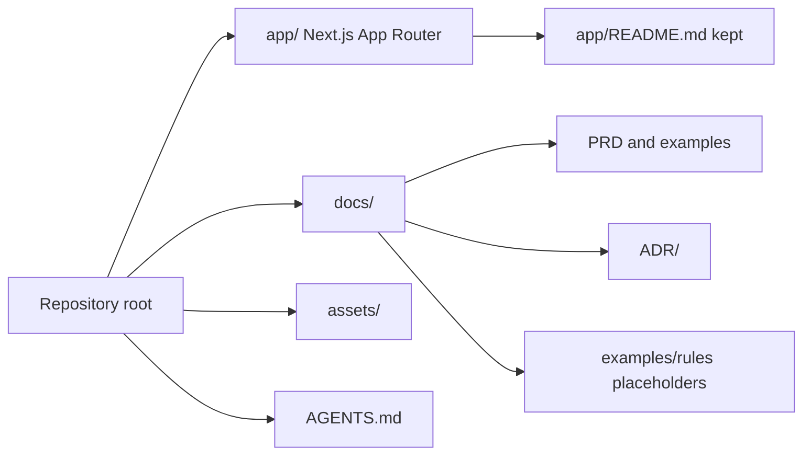

# ADR-001: Project Initialization

**Date:** 2026-10-21
**Status:** Superseded by `docs/ADR/005-starter-template.md`. The Create Next App scaffold below is no longer the plan; the starter template in ADR-005 replaces it. Sections 3 to 5 are kept only as the record of the rejected approach.
**Relates to:** `docs/ADR/000-main-architecture.md`

---

## 1. Scope

How the empty application in `app/` is turned into a Next.js App Router project with TypeScript strict mode, Tailwind CSS and the test tooling from ADR-000, section 10. It covers the scaffold command, the flags, the conflict with the repository's own `AGENTS.md`, and the steps that follow scaffolding. It does not cover application code (ADR-002 to ADR-004).

The starting point is `app/README.md` only. The repository root has its own `AGENTS.md`, which must not be overwritten.

---

## 2. Technology Documentation References

| Library | Context7 ID or official docs | Used for |
|---|---|---|
| Next.js | `/vercel/next.js` and `/websites/nextjs` | `create-next-app` options and the App Router structure |
| Next.js installation guide | https://nextjs.org/docs/app/getting-started/installation | Default setup and the generated agent guidance file |
| Next.js CLI reference | https://nextjs.org/docs/app/api-reference/cli/create-next-app | Flag names used in this ADR |
| Vercel AI SDK | `/vercel/ai` | Installed after scaffolding (ADR-002) |

---

## 3. Component Design

### Scaffold approach

The app directory is not empty, because `app/README.md` already exists. The scaffold must not overwrite it, and the repository root must not gain a second `AGENTS.md`. The implementing agent does this:

1. Create the Next.js project in a temporary directory inside the repository, outside `app/`, using the flags in section 4.
2. Move the generated files into `app/`, keeping `app/README.md`. If the scaffold generates a README, keep the existing one.
3. Remove the temporary directory. Confirm with `git status` that only `app/` and the lockfile changed.

Alternatively, the implementing agent may pass the target path directly if the scaffold tool allows a non-empty directory with an existing README. Either way the outcome must match the file list in section 5.

### Package manager
npm. The Next.js scaffold default. The lockfile is committed.

### Linter
ESLint (the Next.js scaffold default, with the `eslint-config-next` rules). Biome is not used.

### Runtime and language
- TypeScript with `strict: true` in `tsconfig`. The implementing agent confirms this value after scaffolding and does not relax it.
- Node.js LTS compatible with the chosen Next.js version. The exact version is checked against the Next.js documentation at implementation time.

---

## 4. Scaffold Command Parameters

The implementing agent runs `create-next-app` with these parameters. The values come from the Next.js CLI reference.

| Parameter | Value | Reason |
|---|---|---|
| TypeScript | on (`--ts`) | Course requirement |
| App Router | on (`--app`) | Course requirement; ADR-000 |
| Tailwind CSS | on (`--tailwind`) | Matches ADR-004 AI Elements requirement |
| Linter | ESLint (`--eslint`) | Scaffold default; section 3 |
| Source directory | off | Keeps the App Router at `app/` as in the repository layout |
| Import alias | `@/*` | Scaffold default |
| Turbopack | on (default) | Scaffold default |
| Package manager | npm (`--use-npm`) | Section 3 |
| Agent guidance file | off (`--no-agents-md`) | The scaffold can generate its own `AGENTS.md`. The repository already has one (`AGENTS.md` at the root). Generating a second file would conflict. |
| Git initialization | off (`--disable-git`) | The repository is already a git repository |
| Install | on | Dependencies are needed for verification |
| Prompts | suppressed (`--yes`) or every value passed explicitly | The implementing agent passes every value explicitly so the result does not depend on saved preferences |

Note: the scaffold's `--yes` flag uses saved preferences or defaults. Passing every value explicitly is safer than `--yes`.

---

## 5. Expected Project Layout After Scaffolding

Conceptual layout. Exact files depend on the scaffold version.

- `app/` — App Router root with a layout, the home page and global styles
- `app/README.md` — kept from the repository
- `public/` — static assets
- `package.json`, lockfile, `tsconfig.json` (strict), ESLint config, Next.js config, PostCSS and Tailwind config
- `.gitignore` — must include `.env.local` and `node_modules`. The implementing agent checks this entry exists.
- `.env.example` — the repository file (ADR-000, section 7). Not replaced by the scaffold.

Directory placement of the scaffold's `app/` folder: the scaffold places App Router files under `app/` at the repository root. The implementing agent confirms the path after scaffolding and does not nest a second `app/app/`.

---

## 6. Post-Scaffold Steps

The implementing agent completes these steps in order. Each step has a verification.

1. **Confirm the scaffold.** Run the production build and the lint command. Both must pass with no errors or warnings introduced by the scaffold. Record the commands and results.
2. **Install the AI packages.** Install `ai`, `@ai-sdk/react`, `@openrouter/ai-sdk-provider` and `zod`. Pin the AI SDK major version and the `@ai-sdk/react` major version as a compatible pair, confirmed through Context7 (ADR-002, section 3). Verification: `npm ls` shows no peer dependency errors.
3. **Install the test packages.** Install `vitest` and Playwright. Add the test scripts to `package.json`: one for unit and integration tests, one for E2E. Verification: each script runs and reports its discovery count, even when zero tests exist.
4. **Install the chat UI packages.** Set up shadcn/ui and add AI Elements components as described in ADR-004. Verification: the components compile.
5. **Set up environment files.** Copy nothing secret. The real `.env.local` is created locally by the developer with `OPENROUTER_API_KEY` and `LLM_MODEL` (ADR-000, section 7). Verification: `.env.example` is unchanged except where the course agreed otherwise.
6. **Confirm the server boundary.** Add the `server-only` marker package and use it in server modules listed in ADR-000, section 4. Verification: a deliberate import from a client component fails the build in a test, then the test is reverted.
7. **Start the app.** Run the development server and open the home page in the browser. Record successful startup separately from compilation and test execution (AGENTS.md).

---

## 7. Technical Decisions

### Scaffold into `app/` without overwriting the README
**Status:** Accepted
**Date:** 2026-10-21
**Context:** The repository starts with an empty application folder that contains only a README. The scaffold command must produce the App Router project without destroying that README or adding a second `AGENTS.md`.
**Decision:** Scaffold with explicit flags (section 4), in a temporary directory, then move the result into `app/` and keep the existing README.
**Rejected alternatives:**
- Scaffold at the repository root: would mix the Next.js project with course materials and the root `AGENTS.md`.
- Hand-write the project files: the scaffold keeps the current Next.js conventions (configuration, lint and TypeScript setup) that the implementing agent should not reproduce by hand.
**Consequences:**
- (+) Current Next.js defaults; reproducible command.
- (-) A manual move step that the implementing agent must verify with `git status`.
**Review trigger:** If the scaffold tool adds a flag that writes into the repository root.

### Disable the scaffold's agent guidance file
**Status:** Accepted
**Date:** 2026-10-21
**Context:** The Next.js scaffold generates an agent guidance file by default. The repository root already has `AGENTS.md`, which governs this course project.
**Decision:** Pass `--no-agents-md`. The repository's `AGENTS.md` is the only agent guidance file.
**Rejected alternatives:**
- Keep the generated file: two conflicting instruction sets for implementing agents.
**Consequences:**
- (+) One source of agent instructions.
- (-) The generated file's Next.js-specific guidance is not available. The implementing agent reads the current Next.js docs through Context7 instead.
**Review trigger:** If the course adopts per-app agent files.

### npm and ESLint
**Status:** Accepted
**Date:** 2026-10-21
**Context:** The scaffold defaults are npm and ESLint. No requirement in the PRD or the course materials asks for another tool.
**Decision:** Keep the scaffold defaults.
**Rejected alternatives:**
- pnpm or Bun: no benefit for a single small app that a course group will share.
- Biome: a second lint toolchain to learn for no MVP gain.
**Consequences:**
- (+) Familiar tooling for the group.
**Review trigger:** If the group agrees on another package manager.

---

## 8. Diagrams

### 8.1 Initialization flow

### 8.2 Repository layout after initialization

---

## 9. Testing Strategy

### Test scenarios for this area

| Scenario | Type | Input | Expected output | Edge cases |
|---|---|---|---|---|
| Scaffold completes | Verification | Scaffold command with the flags in section 4 | Project files appear in `app/`; no new root `AGENTS.md` | Existing README must survive |
| Build passes | Verification | Production build | Build succeeds with no errors or warnings | Warnings from the scaffold must be fixed or reported |
| Lint passes | Verification | Lint command | No errors | Pre-existing warnings are reported, not hidden |
| TypeScript strict | Verification | Inspect `tsconfig` and run a type check | `strict` is true | A file with an implicit `any` fails the check |
| Dependency conflict | Verification | `npm ls` after installing AI packages | No peer dependency errors | Mismatched AI SDK and `@ai-sdk/react` majors fail here |
| Test runners discover | Verification | Unit and E2E scripts with no tests yet | Both report a discovery count of zero without crashing | A runner that exits with error on zero tests must be configured to pass |
| Secret file ignored | Verification | Create a dummy `.env.local`, check git | File is ignored by git | Missing ignore entry fails the check |
| Server boundary | Verification | Import a server-only module from a client component in a temporary test file | Build fails with the marker error; test is reverted afterwards | Mutation check, then revert |

### Technical acceptance criteria

- **TAC-001-01:** `app/README.md` is unchanged after scaffolding.
- **TAC-001-02:** No `AGENTS.md` other than the root file exists after scaffolding.
- **TAC-001-03:** `tsconfig` has `strict` set to true.
- **TAC-001-04:** Build, lint and start each run separately and each result is recorded.
- **TAC-001-05:** `.env.local` is listed in `.gitignore`.
- **TAC-001-06:** Dependency installation reports no peer dependency errors.

---

## Revision log

- **2026-10-21** Documentation review: no content change. This ADR is superseded by ADR-005; its npm, ESLint, Create Next App and "no second AGENTS.md" (TAC-001-02) statements are historical and do not apply to the template in `app/`. Current commands: `pnpm dev`, `pnpm check` (Ultracite), `pnpm exec next build` (ADR-005 section 6).
