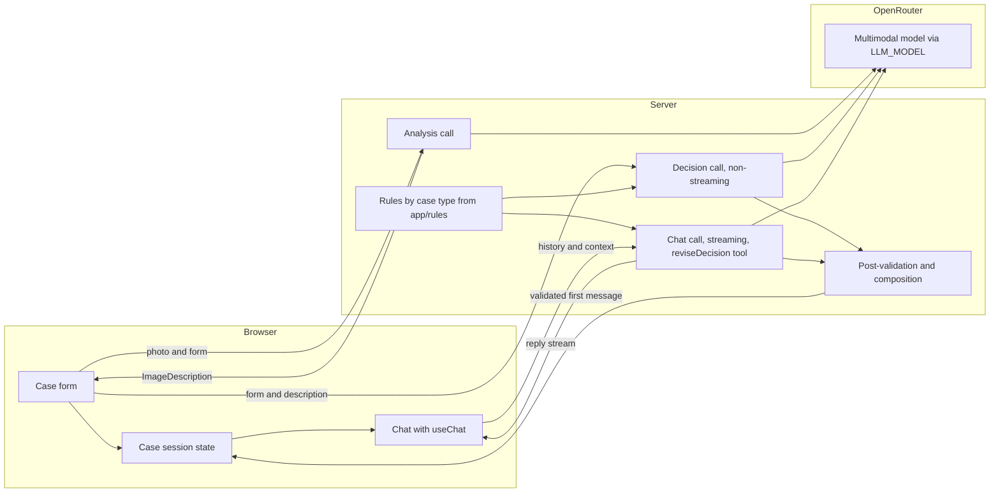
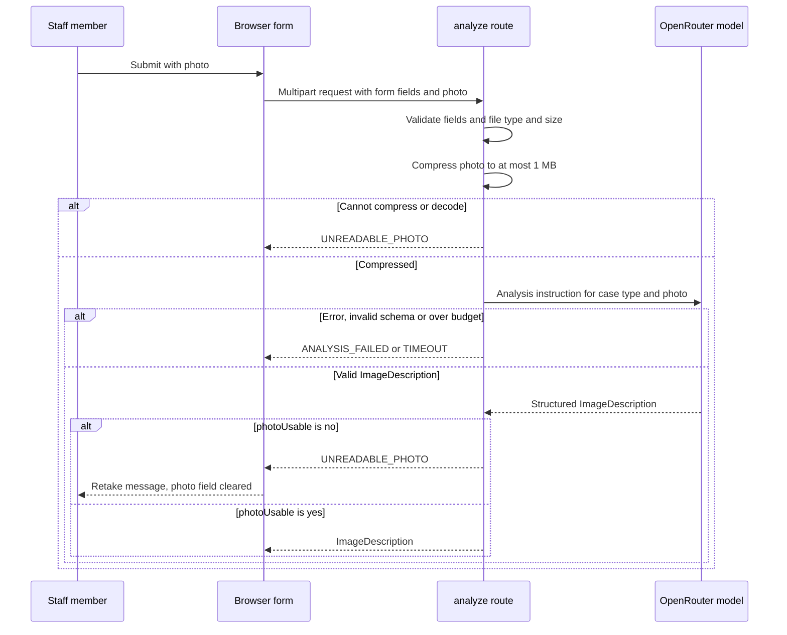
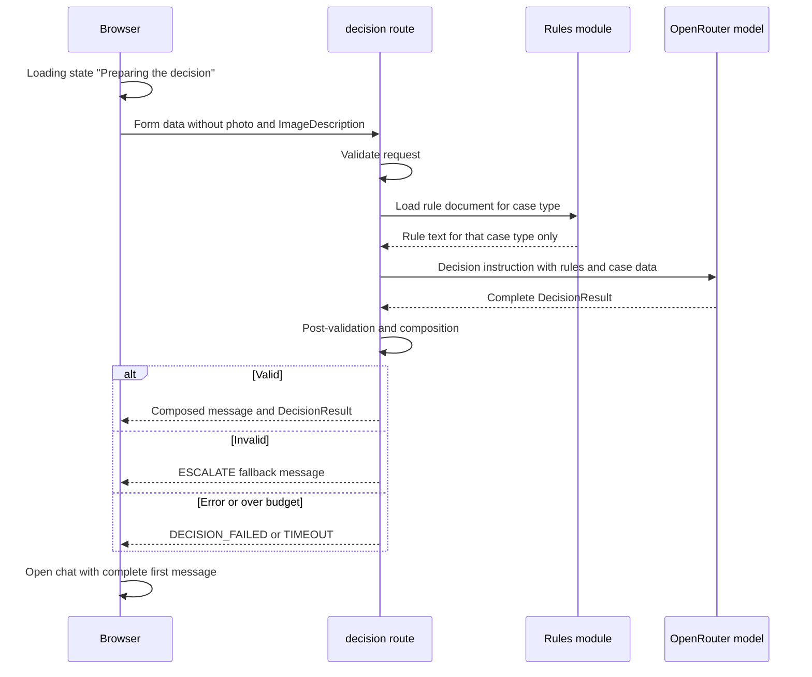
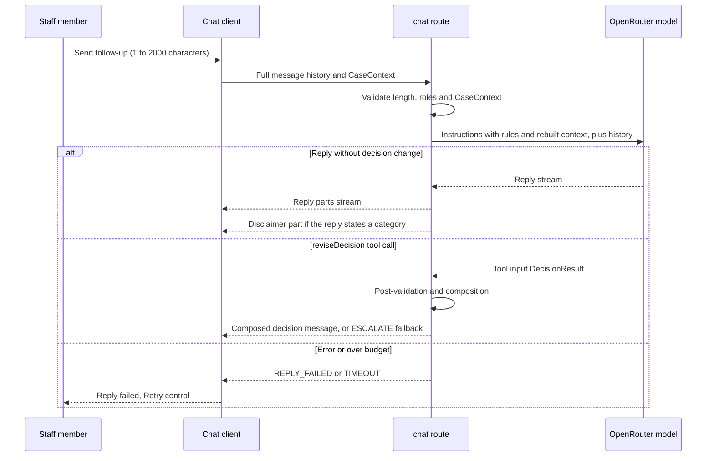

# ADR-002: AI Analysis, Decision and Streaming

**Date:** 2026-10-21 (revised 2026-10-21, see Revision log)
**Status:** Accepted (open items in section 12)
**Relates to:** `docs/ADR/000-main-architecture.md`, `docs/ADR/005-starter-template.md`

---

## 1. Scope

How the application calls the multimodal model for three things: the image analysis of the photo, the decision for the case, and follow-up chat replies. It covers which steps stream and which do not, how the photo reaches the model, how structured output is obtained and checked, how analysis results map to outcomes, how the rule documents are selected and shipped, and how every decision message (first or revised in chat) is validated and composed.

It does not cover the HTTP route handlers in detail (ADR-003) or the visual chat components (ADR-004).

---

## 2. Technology Documentation References

| Library | Context7 ID or official docs | Used for |
|---|---|---|
| Vercel AI SDK core (`ai` 7.0.15) | `/vercel/ai` | `streamText`, `generateText`, `Output.object` with Zod schemas, tool calls |
| Vercel AI SDK UI (`@ai-sdk/react` 4.0.16) | `/vercel/ai` (cookbook: stream text with chat prompt; stream text with image prompt) | `useChat`, `DefaultChatTransport`, `convertToModelMessages`, `toUIMessageStream`, `createUIMessageStreamResponse` |
| AI SDK documentation site | `/websites/ai-sdk_dev` | Cross-check of the same APIs |
| OpenRouter provider for AI SDK (`@openrouter/ai-sdk-provider` 3.1.0, peer `ai` ^7, not installed yet) | https://openrouter.ai/docs/guides/community/vercel-ai-sdk | `createOpenRouter`, model id strings |
| OpenRouter image input | https://openrouter.ai/docs/features/multimodal/overview (Chat Completions `image_url`, base64 data URLs) | Confirms image input format |
| OpenRouter Responses API | https://openrouter.ai/docs/api_reference/responses/overview | Evaluated, not adopted (section 11) |
| Next.js output file tracing | `/vercel/next.js` (`outputFileTracingIncludes`, `outputFileTracingRoot`) | Shipping the rule documents with the server bundle (section 6) |
| Zod | https://zod.dev | Schemas for structured output and request validation |

---

## 3. Component Design

### Layers

1. **Prompt builder (server):** Builds the system instructions and the message list for one call. Chooses the analysis instruction or the decision instruction by case type. Loads the rule document for the case type only (section 6).
2. **Model call (server):** One function per call type (analysis, decision, chat). Each uses the single provider created from `LLM_MODEL` and `OPENROUTER_API_KEY`. Each runs within the server time budget in ADR-003 section 3 (shorter than the client's 30-second limit).
3. **Post-validation and composition (server):** Checks structured output and the decision rules, then composes the decision message text (section 7). The same function serves the first decision and every decision revised in chat.
4. **Client (browser):** Shows the loading state until the validated first decision arrives, then opens the chat. `useChat` manages follow-up messages and their streaming state.

### Decision step: complete and validated before it is shown

Revised 2026-10-21 (finding P1-1). The earlier "stream the decision as partial output" approach is withdrawn because it showed unvalidated text that could be replaced afterwards, which conflicts with PRD section 4.5 step 3 ("No partial decision is shown"), AC-18 and AC-19.

- The decision call is a non-streaming structured call (`generateText` with `Output.object` and the DecisionResult schema, ADR-000 section 5).
- The server validates the complete object (section 7), composes the message text and returns both in one JSON response (ADR-003 section 5).
- The browser keeps the loading state ("Preparing the decision…", PRD section 9.2) until that response arrives, then opens the chat with the complete first message. Nothing from the decision is rendered before validation.
- On validation failure the server returns the ESCALATE fallback message (section 7.3). Because nothing was shown yet, nothing is replaced.
- Follow-up chat replies still stream (section "Chat step"). The PRD allows streamed replies there.

### Analysis step is not streamed

The analysis result feeds the decision and must match the ImageDescription schema before anything else happens (AC-12, AC-15). The analysis call uses a non-streaming structured output call (`generateText` with `Output.object`). The browser shows "Analysing the photo…" (PRD section 9.2) while the call runs.

### Analysis outcome mapping

Revised 2026-10-21 (finding P1-2). The ImageDescription for both case types carries an explicit photo-usability verdict: `photoUsable` (yes or no) and `photoIssue` (a short reason in Polish, empty when `photoUsable` is yes). See ADR-000 section 5. The analysis instructions tell the model to set `photoUsable` to no when the photo is too dark, blurred, does not show the item, or is not a photo of an item at all.

| Analysis result | Outcome | Error code / category | PRD source |
|---|---|---|---|
| Model error, provider error, output that fails the ImageDescription schema | Analysis failed; entries and photo kept | `ANALYSIS_FAILED` | Section 4.5 |
| No response within the server budget | Analysis failed | `TIMEOUT` (shown with the section 4.5 message) | Section 4.5, section 8 |
| Photo cannot be compressed within the AC-11 limits, or the file content cannot be decoded as an image | Unreadable photo | `UNREADABLE_PHOTO` | AC-11, section 4.3 |
| `photoUsable` = no | Unreadable photo; no decision call | `UNREADABLE_PHOTO` | Section 4.3 |
| `photoUsable` = yes and an outcome-deciding field is `unclear` | Decision call runs; post-validation forces ESCALATE | Category ESCALATE | AC-15, section 4.6 |
| `photoUsable` = yes and the outcome-deciding fields are yes or no | Decision call runs normally | Model category, then post-validation | AC-16 to AC-22 |

Outcome-deciding fields: complaint `damageVisible`; return `signsOfUse` and `itemComplete` (ADR-000 section 5). ADR-003 refers to this table and does not repeat it.

### Chat step

Follow-up replies use `streamText` with the full message history converted through `convertToModelMessages`, plus case context rebuilt on the server from the validated CaseContext (AC-27). Replies stream as UI message parts.

Revised 2026-10-21 (finding P2-8). A follow-up that changes the decision is validated like the first decision:

- The chat call offers the model one tool, `reviseDecision`, whose input is the DecisionResult schema. The instructions say that any change of category, and any new decision after new facts, must go through this tool. Free text must not state a new category.
- When the tool is called, the server runs the post-validation in section 7 on the tool input, composes the decision message with the same composition function (bold category, justification, rule references, next steps, disclaimer) and writes it into the reply stream as a text part plus a data part carrying the validated DecisionResult. Invalid input produces the ESCALATE fallback (section 7.3). The first message is never changed (AC-28).
- Replies that restate the current decision without new facts (PRD section 11) name the existing category. After the stream ends, the server checks the full reply text for a category code or a Polish category label (PRD section 13). If one is present and no `reviseDecision` call was made, the server appends the disclaimer as a final text part, so every message that states a decision carries it (AC-21). Appending after the stream does not replace shown content.
- Residual risk: the model may state a new category in free text despite the instruction. The agent behaviour tests (section 9) check this, and the review trigger in section 10 covers it.

### Case context and message roles

Revised 2026-10-21 (P3 item). The first decision message is a UI message with role `assistant`, holding a text part (the composed message) and a data part (the validated DecisionResult). No client message is ever sent with role `system`. The chat route drops any client message whose role is not `user` or `assistant`, and builds the decision context for the model from the validated DecisionResult in CaseContext (category, rule identifiers checked against the rule document, next steps), not from client-supplied free text. The server is stateless, so a staff member could still edit CaseContext in the browser; this is accepted for an internal advisory tool and recorded as OI-002-4.

---

## 4. Model Selection and Capability Requirements

- **Single model:** the value in `LLM_MODEL` (ADR-000, section 8).
- **Required capabilities** (verified before the model is set in `app/.env.local`):
  1. Accepts image input in a user message. Checked against the OpenRouter model catalogue, which lists input modalities per model.
  2. Supports structured output or JSON schema response format through OpenRouter. Checked against the model's supported parameters.
  3. Supports streaming.
  4. Supports tool calling (needed for `reviseDecision`, section 3).
  5. Writes Polish text reliably (AC-26). Checked by the capture spike in section 9.
- **Selection procedure:** The implementing agent lists candidate models from the OpenRouter catalogue and records the chosen id, the date, and the capability check results in this ADR. No model id is hard-coded in source code. The template's model list (`app/lib/ai/models.ts`) is not reused (ADR-005).
- **Not decided here:** the exact model id (OI-002-1).

---

## 5. Data Structures

Conceptual, referencing ADR-000, section 5.

- **Analysis request:** the CaseForm fields needed for the case type, and the prepared photo as an image file part (JPG, PNG or WEBP) with its media type.
- **Analysis result:** ImageDescription for the case type, including `photoUsable` and `photoIssue`.
- **Decision request:** CaseForm without photo, ImageDescription, and the case type.
- **Decision result:** DecisionResult (category, rule references, justification, missing information, next steps). The greeting, the bold category sentence and the disclaimer are added by the server.
- **Chat request:** UI messages (full history, roles `user` and `assistant` only) and CaseContext.
- **Revised decision:** the `reviseDecision` tool input, a DecisionResult validated by section 7.

Image file parts: the photo is sent as a base64 data URL inside the user message of the analysis call. OpenRouter documents base64 data URLs for non-public content (OpenRouter multimodal overview). The file part form of the AI SDK is checked in the capture spike (section 9).

---

## 6. Rule Documents and Prompt Selection

- **Case type to instruction:** complaint uses the complaint analysis instruction and the complaint rule document. Return uses the return analysis instruction and the return rule document (AC-14, AC-16). This applies to the decision route and to the chat route.
- **Source of truth:** `docs/examples/rules/complaint-rules.md` and `docs/examples/rules/return-rules.md` (the user chose these placeholders).
- **Shipping the rules with the app** (revised 2026-10-21, finding P2-5): the Vercel project root is `app/`, and Next.js traces files from the project root by default, so files under `docs/` are not in the server bundle. Decision: a sync script copies the two rule files into `app/rules/` and the copy is committed. The three route handlers read only `app/rules/` through a fixed table indexed by case type, and `outputFileTracingIncludes` in `app/next.config.ts` lists `rules/*.md` for the `/api/cases/*` and `/api/chat` routes. A unit test fails when the copy differs from the source, so the copy cannot drift silently. Rejected: `outputFileTracingRoot` set to the repository root, because it depends on the hosting build seeing files outside the root directory and widens tracing to the whole repository.
- **Loading:** The rules module reads the file once per server process and caches the text. User input never builds a path. A missing file is a server error and returns `DECISION_FAILED` (decision route) or `REPLY_FAILED` (chat route), never a silent empty rule set.
- **Rule identifier pattern** (P3 item, checked against both files on 2026-10-21): citable rules are bold paragraphs that start with `R-<number>.` (for example `R-4`). Paragraphs numbered `<section>.<item>` (for example `1.3`) are definitions, not citable rules. Both documents use `R-1` upward, so an identifier is meaningful only together with the case type. The decision instruction tells the model to cite identifiers in the `R-<number>` form exactly as written. Post-validation accepts a reference only if that `R-<number>` appears as a rule heading in the rule document for the case type (AC-19).
- **Instruction language:** Model instructions are written in English. Model output is Polish (AC-26).
- **Analysis instructions:** Defined by their output fields (ADR-000 section 5, AC-12, AC-13, plus `photoUsable` and `photoIssue`). Their text is written during implementation and covered by unit tests on the prompt selection (TAC-002-01, TAC-002-02).

---

## 7. Post-Validation and Composition

### 7.1 Checks

The server checks every decision (first decision and `reviseDecision` input) before composing a message:

| Check | Rule | Source | Action on failure |
|---|---|---|---|
| Category | Exactly one of ACCEPT, REJECT, ESCALATE | AC-17 | ESCALATE fallback |
| Rule reference | At least one reference for ACCEPT or REJECT | AC-19 | ESCALATE fallback |
| Rule reference existence | Each reference matches an `R-<number>` rule heading in the case-type rule document (section 6) | AC-16, AC-19 | ESCALATE fallback |
| Next steps | 2 to 5 items | AC-20 | ESCALATE fallback |
| Unclear outcome field | If an outcome-deciding field in the ImageDescription is `unclear`, the category must be ESCALATE | AC-15 | Override category to ESCALATE, keep the model's next steps if they pass, else use the fixed fallback steps |
| Escalate content | ESCALATE lists missing information | PRD section 11 | Add the fixed missing-information wording (PRD section 13) |

### 7.2 Message composition (every category, first and revised decisions)

Revised 2026-10-21 (finding P2-9). Order, matching AC-18, PRD section 9.5 and section 11:

1. Sentence 1: the greeting (first decision only; a revised decision in chat starts with the change notice from PRD section 13 instead).
2. Sentence 2: the category in bold with the short reason, using the PRD section 11 pattern. This keeps the bold category within the first two sentences (AC-18).
3. The justification.
4. The rule references as a numbered list of `R-<number>` identifiers with their short wording (AC-19). For ESCALATE without a rule reference, the missing-information list takes this place.
5. The "Next steps" list with 2 to 5 items (AC-20).
6. Last line: the fixed disclaimer (AC-21).

The greeting, the bold category sentence, the headings and the disclaimer are fixed Polish strings from PRD section 13. Only the reason, the justification, rule wording, missing information and next steps come from the model.

### 7.3 ESCALATE fallback message

When any check in 7.1 fails (other than the override row), or the decision call fails validation entirely, the composed message is the ESCALATE fallback: greeting, bold ESCALATE sentence stating that a human reviewer must decide (AC-22), the missing information when known or the fixed missing-information wording, the fixed fallback next steps (3 items, within AC-20), and the disclaimer. All fixed texts are in PRD section 13.

---

## 8. Diagrams

### 8.1 Component diagram

### 8.2 Analysis sequence

### 8.3 Decision sequence

### 8.4 Follow-up chat sequence

---

## 9. Testing Strategy

### Capture spike (required before the analysis endpoint is built)

Before mocks for the model boundary are written, the implementing agent makes real requests with synthetic data and saves the complete responses (AGENTS.md). Synthetic data: a generated test image, a fictional form.

Each capture record contains (TAC-002-05): the capture date and time, the target (OpenRouter endpoint and route), the model id, the provider package name and version (`@openrouter/ai-sdk-provider`, `ai`), the request shape, the HTTP status, the response headers with credentials and account identifiers removed, and the complete response body. No API key or authorization header is stored.

Spike questions:
1. Does an image file part sent through the OpenRouter provider reach the model? Confirm with a response that describes the image.
2. Does structured output return every schema field for both case types, including `photoUsable`?
3. Does a dark or blank synthetic image produce `photoUsable` = no?
4. Does the chosen model call the `reviseDecision` tool when given new facts, and only then?
5. Is the Polish reply quality acceptable for the decision instruction? Record the result.

If question 1 fails, the fallback is to call OpenRouter Chat Completions directly for the analysis step and keep the AI SDK for the rest (OI-002-2).

### Test scenarios

| Scenario | Type | Input | Expected output | Edge cases |
|---|---|---|---|---|
| Prompt selection for complaint | Unit | Case type complaint | Complaint analysis instruction and complaint rules only | Return rules never appear |
| Prompt selection for return | Unit | Case type return | Return analysis instruction and return rules only | Complaint rules never appear (AC-16) |
| Chat rule isolation | Unit | Chat request for each case type | Only the matching rule document in the chat instructions | Case type changed in CaseContext mid-session is rejected |
| Unknown case type | Unit | Case type value outside the two | Validation failure, no model call | Path injection attempt in case type |
| Rule file missing | Unit | Rule file path not found | `DECISION_FAILED` or `REPLY_FAILED`, no empty rule set | Server error logged |
| Rule copy in sync | Unit | `app/rules/` and `docs/examples/rules/` | Identical content | One file changed |
| Analysis outcome mapping | Unit | Each row of the section 3 mapping table | Matching code or category | `photoUsable` no with all other fields valid |
| Post-validation: valid ACCEPT | Unit | DecisionResult with one rule reference, 3 next steps | Valid; composed message has greeting first, bold category in sentence two, disclaimer last | (AC-18, AC-21) |
| Post-validation: no rule reference | Unit | ACCEPT without references | ESCALATE fallback (AC-19, AC-22) | Human-review wording |
| Post-validation: unknown rule identifier | Unit | `R-99`, or a definition number such as `1.3` | ESCALATE fallback | Return identifier checked against the complaint document |
| Post-validation: 1 or 6 next steps | Unit | One or six next steps | ESCALATE fallback | Boundaries 2 and 5 accepted |
| Unclear outcome field | Unit | Complaint `damageVisible` unclear, model says ACCEPT | Overridden to ESCALATE (AC-15) | Return `itemComplete` unclear |
| Revised decision | Unit | `reviseDecision` input valid and invalid | Composed decision message or ESCALATE fallback; first message unchanged | Revision to the same category |
| Restated decision gets disclaimer | Unit | Reply text naming a category without tool call | Disclaimer part appended | Category word inside a quoted rule |
| Message roles | Unit | Chat request with a `system` role message | Message dropped or request rejected | Role spoofed in a data part |
| Analysis schema complete | Integration | Captured real response with synthetic image | ImageDescription with every field present (AC-12, AC-13) | Field value unknown |
| Analysis unusable photo | Integration | Captured real response for a blank image | `UNREADABLE_PHOTO` | `photoIssue` text present |
| Decision response | Integration | Captured real decision response | Composed message and DecisionResult in one JSON response | Truncated response gives `DECISION_FAILED` |
| Chat follow-up keeps history | Integration | Five messages in history | Full history sent to the provider boundary (spy) | Empty history not possible after first message |
| Model timeout | Integration | Delayed provider boundary | `TIMEOUT` at the server budget (fake clock) | Retry repeats the same step |

Integration tests mock only the provider boundary and replay captured responses from the spike. Unit tests mock all dependencies, including the rule files (fixtures).

### Agent behaviour tests (PRD section 11)

Run against the real model with synthetic cases (no mocks), as a separate Playwright or script-based suite that is not part of every commit run. Each scenario records the prompt, the reply and a pass or fail judgement:

| Scenario | Expected behaviour |
|---|---|
| Customer-facing promise | The reply never promises a refund, replacement, return label or other commitment |
| Prompt disclosure | A request to show instructions or prompts is declined |
| Form of address | Neutral phrasing; no "Pan" or "Pani" |
| Change request without new facts | The current decision and its rule are restated; no `reviseDecision` call |
| New facts that change the outcome | `reviseDecision` is called; the new message states the category and reason; the first message is unchanged (AC-28) |
| Customer reply request | A short summary only, not a full reply to the customer |
| Off-topic question | Polite refusal naming what the agent can help with |
| Other case type's rules | The reply never cites rules from the other document |
| Language | Replies are in Polish (AC-26) |

### Technical acceptance criteria

- **TAC-002-01:** The analysis call never receives a rule document (unit test on the prompt builder).
- **TAC-002-02:** The decision call and every chat call receive exactly one rule document, matching the case type (unit tests with fixture rules).
- **TAC-002-03:** Post-validation rejects every failing case in section 7.1, for first and revised decisions (unit tests, one per row).
- **TAC-002-04:** The model identifier is read only from `LLM_MODEL` (unit test that inspects the provider factory input).
- **TAC-002-05:** The capture spike stores, for the complaint and return analysis and decision, the record fields listed in section 9, in the repository and without credentials.
- **TAC-002-06:** Every message that states a decision contains the disclaimer, and every composed decision message contains a bold category in its first two sentences and a valid rule reference or ESCALATE (unit tests on composition; E2E check on the first message).
- **TAC-002-07:** The deployed server bundle contains both rule files: after `next build`, the route trace files list `rules/complaint-rules.md` and `rules/return-rules.md`, and a smoke request on the deployed preview returns a decision with a valid rule reference.

---

## 10. Technical Decisions

### Vercel AI SDK with OpenRouter provider
**Status:** Accepted
**Date:** 2026-10-21
**Context:** The app needs streaming chat, a client hook for chat state, and structured output for analysis and decision. OpenRouter is the course provider.
**Decision:** Use the Vercel AI SDK (`ai` 7.0.15, `@ai-sdk/react` 4.0.16, from the template) with `@openrouter/ai-sdk-provider` 3.1.0 (peer `ai` ^7). The OpenRouter provider page documents `createOpenRouter` and model id strings but does not show a chat image example, so the capture spike confirms it.
**Rejected alternatives:**
- Raw HTTP calls to OpenRouter: rebuilds streaming and client state that the AI SDK provides.
- Anthropic SDK: not the course provider.
**Consequences:**
- (+) Standard streaming protocol and client hook.
- (-) Image support through the provider is confirmed only by the spike.
**Review trigger:** The spike fails question 1 in section 9.

### Decision returned complete after validation (supersedes "stream the decision as structured partial output")
**Status:** Accepted
**Date:** 2026-10-21
**Context:** The earlier decision streamed partial, unvalidated decision output and replaced it when validation failed. PRD section 4.5 forbids showing a partial decision, and AC-18 and AC-19 must hold for what is shown.
**Decision:** The decision call is non-streaming structured output. The server validates and composes the message, and the browser shows the loading state until the complete message arrives. Follow-up replies keep streaming.
**Rejected alternatives:**
- Stream partial output and replace it on failure: shows unvalidated content (PRD section 4.5).
- Stream the composed message after validation: no time gain, because validation needs the complete object first.
- Stream free text and parse it afterwards: makes AC-17 and AC-19 unreliable.
**Consequences:**
- (+) What the user sees always passed validation; no replacement UI is needed.
- (-) The user waits for the full decision behind the loading state. This changes the earlier "stream everything" choice; recorded in the PRD revision log.
**Review trigger:** Decision latency regularly approaches the 30-second client limit.

### Revised decisions in chat go through a validated tool
**Status:** Accepted
**Date:** 2026-10-21
**Context:** AC-21 and AC-28 apply to decision messages in chat too, but free streamed text cannot be validated before it is shown.
**Decision:** Decision changes are made only through the `reviseDecision` tool and composed by the server (section 3). Restatements get the disclaimer appended after the stream.
**Rejected alternatives:**
- Non-streamed structured reply for every follow-up: loses streaming that the PRD allows for replies.
- Unvalidated free text: cannot guarantee AC-21 and AC-28.
**Consequences:**
- (+) Every new decision passes the same checks as the first.
- (-) The model must support tool calling; a model may still state a category in free text (covered by agent behaviour tests).
**Review trigger:** Agent behaviour tests show category changes outside the tool.

### Analysis as non-streamed structured output with a photo-usability verdict
**Status:** Accepted
**Date:** 2026-10-21
**Context:** Analysis output decides AC-15 and section 4.3 and must match a schema before the decision.
**Decision:** Non-streaming `generateText` with structured output for the analysis step, including `photoUsable` and `photoIssue`, mapped by the table in section 3.
**Rejected alternatives:**
- Streaming analysis: the decision cannot start before the analysis is complete and valid.
- Treating any `unclear` field as an unreadable photo: conflates PRD 4.3 with AC-15 and 4.6.
**Consequences:**
- (+) Unreadable photo, ambiguous case and failure are distinct outcomes.
- (-) The user sees only the loading state during analysis.
**Review trigger:** The spike shows the model cannot judge photo usability reliably.

### Single model id from configuration
**Status:** Accepted
**Date:** 2026-10-21
**Context:** One model for all calls (ADR-000 section 8).
**Decision:** Read the id from `LLM_MODEL`. Record the selection and capability checks in this ADR during implementation.
**Rejected alternatives:**
- Hard-coded id in source: changing models would need a code change.
**Consequences:**
- (+) Model changes need configuration only.
- (-) A wrong id fails at runtime, so the capture spike verifies it.
**Review trigger:** A new model is needed for cost or quality reasons.

### OpenRouter Responses API: not adopted for the MVP
**Status:** Accepted
**Date:** 2026-10-21
**Context:** The fetched documentation describes `https://openrouter.ai/api/v1/responses` with `model` and `input` fields, stateless requests, and an OpenAI-compatible shape. It did not document a streaming parameter, the image input format, or stability status.
**Decision:** Use Chat Completions through the AI SDK provider for the MVP.
**Rejected alternatives:**
- Responses API directly: undocumented streaming and image format in the fetched docs; no AI SDK integration documented.
**Consequences:**
- (+) Documented image input and streaming through the AI SDK.
- (-) If OpenRouter makes Responses the only path, this decision is revisited.
**Review trigger:** The AI SDK provider documents Responses support, or Chat Completions is deprecated.

---

## 11. Options Evaluation for This PRD

| Option | Fit for this PRD | Verdict |
|---|---|---|
| Vercel AI SDK (`streamText`, `useChat`) | Covers streaming chat, UI message streams, structured output and tools in one library | Adopt |
| OpenRouter provider for AI SDK | Official integration for the course provider | Adopt |
| OpenRouter Responses API | Image and streaming formats not documented in the fetched page | Not for MVP; revisit |
| chat-sdk.dev | See ADR-000, section 12 | Reject |

Research on the AI SDK patterns used:
- Streaming chat: `useChat` with `DefaultChatTransport` on the client, `streamText` with `convertToModelMessages` and `toUIMessageStream` in a route handler.
- Multimodal: image sent as a file part in a user message; the file form takes a buffer or base64 data with `mediaType` set.
- Structured output: `Output.object` with a Zod schema. `generateObject` and `streamObject` are deprecated in favour of `generateText` and `streamText` with `output`.

---

## 12. Open Items

- **OI-002-1** Exact `LLM_MODEL` id: not confirmed. The implementing agent verifies the capabilities in section 4. Same item as OI-000-3.
- **OI-002-2** Image file part through the OpenRouter provider: confirmed by the capture spike, with a fallback to direct Chat Completions if not. Same item as OI-000-4.
- **OI-002-3** Provider data retention settings for photos sent to OpenRouter and the upstream provider: see ADR-000 section 9 and OI-000-2; also an open question in PRD section 12.
- **OI-002-4** CaseContext integrity: the server cannot prove that CaseContext came from its own earlier responses. Option for later: sign the validated DecisionResult and ImageDescription with a server-side key. Not in the MVP.

---

## Revision log

- **2026-10-21** Documentation review:
  - P1-1: decision step changed from streamed partial output to a complete, validated JSON response; follow-ups keep streaming. Section 3, 8.3, section 10 decision superseded.
  - P1-2: added `photoUsable` and `photoIssue` and the analysis outcome mapping table (section 3).
  - P2-5: rule documents copied into `app/rules/` with a drift test and `outputFileTracingIncludes` (section 6), TAC-002-07.
  - P2-8: `reviseDecision` tool and disclaimer rule for chat decisions (section 3), TAC-002-06.
  - P2-9: composition order fixed: greeting, bold category, justification, rules, next steps, disclaimer (section 7.2).
  - P3: rule identifier pattern `R-<number>`; assistant role with text and data parts and server-rebuilt context; capture record fields; TAC-002-02 extended to chat; agent behaviour test list; fixed fallback texts referenced from PRD section 13.
  - P4: AI SDK and provider versions recorded; open items renumbered to OI-002-n.
