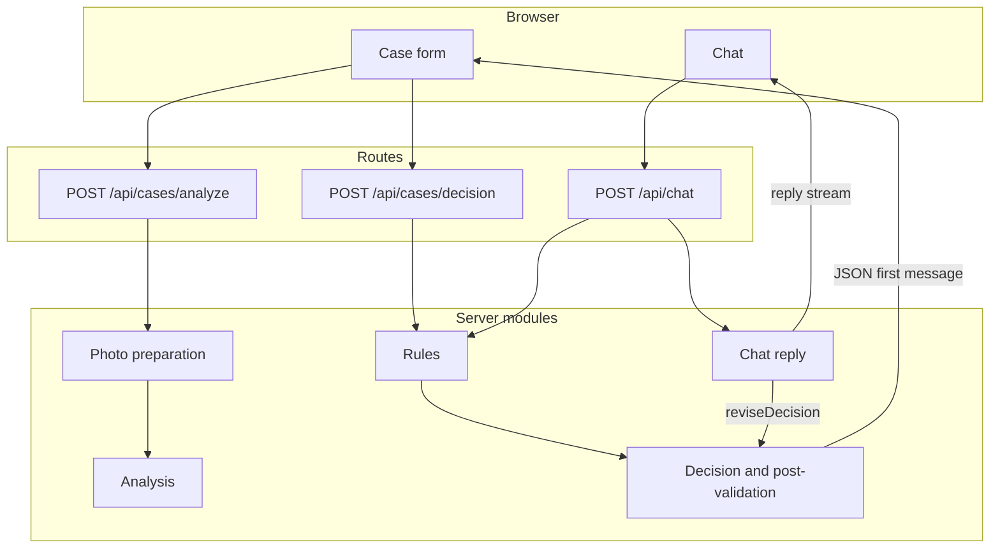
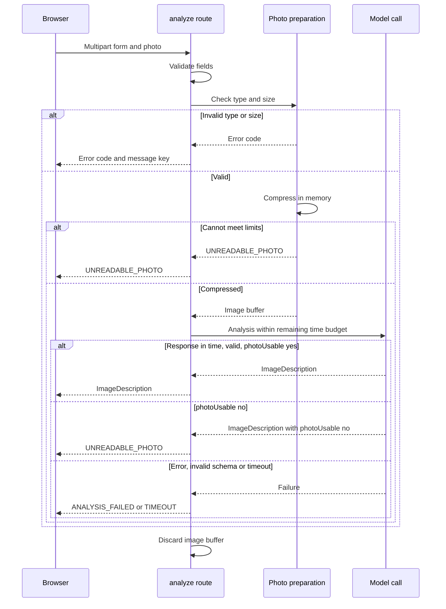
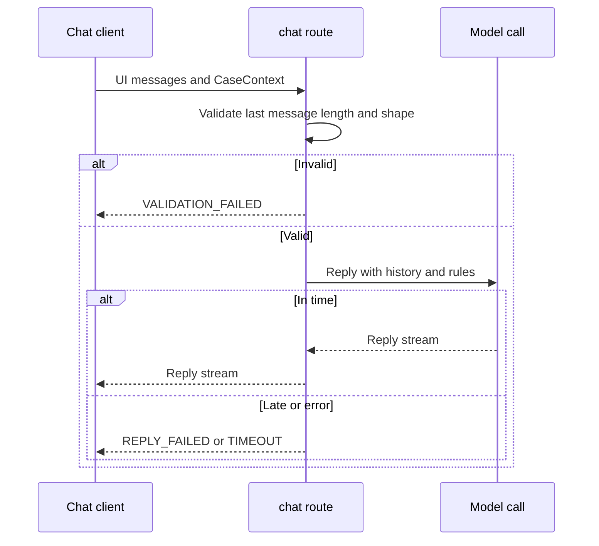

# ADR-003: Backend API and Photo Preparation

**Date:** 2026-10-21
**Status:** Accepted (revised 2026-10-21, see Revision log)
**Relates to:** `docs/ADR/000-main-architecture.md`, `docs/ADR/002-ai-analysis-and-decision.md`, `docs/ADR/005-starter-template.md`

---

## 1. Scope

The three route handlers (`analyze`, `decision`, `chat`), request validation, photo validation and compression, error mapping, timeouts and the runtime settings. It does not cover the model prompts (ADR-002) or the browser components (ADR-004).

---

## 2. Technology Documentation References

| Library | Context7 ID or official docs | Used for |
|---|---|---|
| Next.js route handlers (16.2.10) | `/vercel/next.js` | Handlers under `app/app/` (for example `app/app/(chat)/api/chat/route.ts`), `maxDuration`, runtime selection, `outputFileTracingIncludes` |
| Vercel AI SDK | `/vercel/ai` | `createUIMessageStreamResponse`, `toUIMessageStream`, `convertToModelMessages` |
| Zod | https://zod.dev | Request and model output validation |
| Image compression library | Not chosen yet. Candidate to verify with Context7 at implementation. | AC-11 compression |

---

## 3. Component Design

### Photo preparation (server, `photo-preparation`)

Order of steps for `/api/cases/analyze`:

1. Read the multipart body. Confirm exactly one file part is present (AC-07).
2. Check the declared media type and the content signature: JPG, PNG or WEBP (AC-09). The check uses the file content, not only the declared type. A file whose signature is not one of the three is rejected with `UNSUPPORTED_FILE_TYPE`.
3. Check the size before compression: 10 MB or less (AC-10). Larger files are rejected with `FILE_TOO_LARGE`.
4. Compress in memory to at most 1 MB while keeping the longest side at least 1024 px (AC-11). The compression step tries to reduce quality or format first, and never reduces the longest side below 1024 px. If the photo cannot meet both limits, or its content cannot be decoded, the result is `UNREADABLE_PHOTO` (PRD section 4.3).
   - Photos whose longest side is already below 1024 px cannot meet the "at least 1024 px" limit. Decision (literal reading of AC-11): they are rejected with `UNREADABLE_PHOTO`. Upscaling is rejected because it adds no detail. This is listed for the user's confirmation (OI-003-1).
5. Pass the compressed image to the analysis call (ADR-002).
6. Discard the image buffer when the response is sent. Nothing is written to disk or to a store (AC-35). No image bytes are returned to the client.

Readability after compression is judged by the model through the `photoUsable` field. The mapping from analysis results to `UNREADABLE_PHOTO`, ESCALATE, `ANALYSIS_FAILED` and `TIMEOUT` is defined once in ADR-002 section 3 ("Analysis outcome mapping") and is not repeated here. The mapping is written as unit tests before the endpoint is built.

### Request handling (server, route handlers)

Every route:
1. Parses the body (multipart for analyze, JSON for decision and chat).
2. Validates the body with the shared schema (ADR-000 section 5). Failure: `VALIDATION_FAILED`, no model call.
3. Calls the module for its step (ADR-002).
4. Maps module errors to the error codes in ADR-000 section 5.
5. Returns the response. Only `/api/chat` streams, using the AI SDK UI message stream helpers. Analyze and decision return JSON.

Error response format: a JSON body with the error code and the PRD message key for that code. The client shows the Polish text from PRD section 13. Error details (stack traces, provider responses) are logged on the server and never returned to the browser.

Unknown errors (P4 item): an error that matches no specific code maps to the route's own failure code: `ANALYSIS_FAILED` for analyze, `DECISION_FAILED` for decision, `REPLY_FAILED` for chat. There is no separate generic code.

### Timeouts

Revised 2026-10-21 (ADR-000 section 6):
- The client's 30-second limit per request is binding.
- Each route has a server budget of 25 seconds from receiving the request. For analyze, compression gets a budget of 5 seconds and the model call receives the remainder. For decision and chat, the model call receives the full budget. These values are proposals for implementation and are verified with a fake clock in tests and measured in Manual QA.
- A timeout returns `TIMEOUT`. For the chat stream, the stream ends with an error part and the client shows the AC-25 message with Retry.

### Runtime and limits

- Runtime: Node.js for all three routes (compression needs Node modules).
- `maxDuration`: set above 30 seconds so the application limits are binding. The template already sets `maxDuration = 60` in `app/app/(chat)/api/chat/route.ts`; the same value is proposed for the two new routes. Confirm against the Vercel plan limits (OI-000-6).
- Request body size: see ADR-000 section 9 and OI-000-1. If the hosting body limit is below 10 MB, the browser reduces the photo size before upload; this is a deviation from the PRD's "backend compresses" wording and needs the user's approval before it is built.
- Concurrency: no shared state, so requests are independent. The implementing agent does not add a queue.

### Chat route rework (from the template)

The real file is `app/app/(chat)/api/chat/route.ts` (URL `/api/chat`). ADR-005 section 4 lists what is removed. For this ADR, the request contract changes to: the full UI message history (roles `user` and `assistant`, text and data parts only, no file parts) plus CaseContext. The last user message is 1 to 2000 characters (AC-24). The route keeps no state and reads nothing from a database.

---

## 4. Data Structures

Request and response shapes, conceptual. Full field lists are in ADR-000 section 5.

- **Analyze request:** multipart with the form fields (case type, category, model name, purchase date, reason) and one photo file.
- **Analyze response:** ImageDescription for the case type (including `photoUsable` and `photoIssue`), or an error code. No image data.
- **Decision request:** JSON with case type, form fields without photo, and ImageDescription.
- **Decision response:** JSON with the composed first message text and the validated DecisionResult (revised 2026-10-21; no stream).
- **Chat request:** JSON with the UI message history and CaseContext.
- **Chat response:** UI message stream with the reply; a revised decision arrives as a composed text part plus a data part (ADR-002 section 3).

---

## 5. Interface Contracts

| Endpoint | Input | Success output | Errors (code, PRD message) | Notes |
|---|---|---|---|---|
| `POST /api/cases/analyze` | Multipart: fields and one photo | ImageDescription (JSON) | `UNSUPPORTED_FILE_TYPE` (AC-09), `FILE_TOO_LARGE` (AC-10), `VALIDATION_FAILED` (AC-03 to AC-05, AC-07), `UNREADABLE_PHOTO` (section 4.3), `ANALYSIS_FAILED` (section 4.5), `TIMEOUT` | Non-streaming; within the 25-second server budget |
| `POST /api/cases/decision` | JSON: case, ImageDescription | JSON: composed message and DecisionResult | `VALIDATION_FAILED`, `DECISION_FAILED` (section 4.5), `TIMEOUT` | Non-streaming; ESCALATE fallback on post-validation failure (AC-22); nothing partial is sent |
| `POST /api/chat` | JSON: UI messages, CaseContext | UI message stream with the reply | `VALIDATION_FAILED` (AC-24), `REPLY_FAILED` (AC-25), `TIMEOUT` | Streaming; full history per request (AC-27); rule document for the case type only |

Authentication: none (PRD section 7). The template's Auth.js session check and BotID check are removed (ADR-005).
Rate limiting: none in the MVP. The template's Redis IP rate limit and per-user entitlements are removed (ADR-005). The implementing agent records any platform-level limit in the Manual QA report.

---

## 6. Technical Decisions

### Node.js runtime for route handlers
**Status:** Accepted
**Date:** 2026-10-21
**Context:** The compression step needs image processing libraries that depend on Node modules.
**Decision:** All three route handlers run on Node.js.
**Rejected alternatives:**
- Edge runtime: restricted Node APIs make image compression harder; no benefit for an MVP.
**Consequences:**
- (+) Standard image libraries work.
- (-) Cold starts are slower than Edge.
**Review trigger:** A lighter compression approach works on Edge.

### Compression on the server, in memory
**Status:** Accepted
**Date:** 2026-10-21
**Context:** AC-11 requires server-side compression. AC-35 forbids storage.
**Decision:** Compress in memory inside the analyze request. No disk writes, no object storage.
**Rejected alternatives:**
- Client-side compression only: contradicts AC-11.
- Storing originals for later compression: contradicts AC-35.
**Consequences:**
- (+) No stored photos; simple lifecycle.
- (-) Compression time counts against the 30-second limit.
**Review trigger:** Compression time regularly exceeds the budget on the target platform.

### Client-side resizing only if the hosting body limit requires it
**Status:** Proposed
**Date:** 2026-10-21
**Context:** The hosting platform limits request body size. The PRD allows 10 MB uploads (AC-10) and expects backend compression (AC-11). If the platform limit is smaller than 10 MB, a 10 MB photo cannot reach the backend.
**Decision:** Do not build client-side resizing until the body limit is confirmed from the Vercel documentation. If it is needed, the browser reduces the file before upload, the backend still applies AC-11, and the user approves this change to the PRD wording (OI-000-1).
**Rejected alternatives:**
- Raise the limit by splitting uploads: complex, and a 10 MB single photo still needs one request.
**Consequences:**
- (+) The PRD limit can be kept if the platform allows it.
- (-) Client-side code is needed in that case.
**Review trigger:** Confirmation of the platform body limit.

### Validation with a shared schema before any model call
**Status:** Accepted
**Date:** 2026-10-21
**Context:** The PRD sets field rules (AC-01 to AC-06, AC-24) that must hold before cost is incurred.
**Decision:** Every route validates with the shared Zod schema first. Failure returns `VALIDATION_FAILED` with no model call.
**Rejected alternatives:**
- Validation only in the browser: the server must enforce the rules too.
**Consequences:**
- (+) One rule set for client and server.
- (-) Schema changes affect both sides; the single shared module keeps them aligned.
**Review trigger:** None expected.

### Error codes returned, messages from the PRD
**Status:** Accepted
**Date:** 2026-10-21
**Context:** PRD messages are fixed text (sections 4.3, 4.5, AC-09, AC-10, AC-25). Internal errors must not reach the user.
**Decision:** Return error codes. The client maps codes to the PRD's Polish messages. Provider and stack details are logged on the server only.
**Rejected alternatives:**
- Returning provider error text to the browser: leaks internals and breaks AC-33 (Polish UI text).
**Consequences:**
- (+) Consistent Polish messages.
- (-) New error cases need a code and a message.
**Review trigger:** None expected.

---

## 7. Diagrams

### 7.1 Route handler data flow

### 7.2 Analyze request sequence with timeout

### 7.3 Chat request sequence

---

## 8. Testing Strategy

### Test scenarios

| Scenario | Type | Input | Expected output | Edge cases |
|---|---|---|---|---|
| Field validation | Unit | Each field at minimum, maximum, below minimum, above maximum | Accepts or rejects per AC-03 to AC-06 | Reason required for complaint, optional for return |
| Future purchase date | Unit | Tomorrow's date in `Europe/Warsaw`, with a fixed clock | Rejected (AC-04) | Today accepted; clock at 23:30 UTC (already the next day in Warsaw) |
| Photo count | Unit | Zero files, two files | Rejected (AC-07) | One file accepted |
| File type by content | Unit | PNG with JPG extension, text file renamed to .png | Accepted only for real JPG, PNG, WEBP (AC-09) | Uppercase extension |
| File size | Unit | 10 MB exactly, 10 MB plus one byte | Accepted at 10 MB, rejected above (AC-10) | Size checked before compression |
| Compression decision logic | Unit | Image library mocked: reports sizes and dimensions | Chooses quality steps, never below 1024 px, returns `UNREADABLE_PHOTO` when limits cannot be met | Longest side below 1024 px |
| Compression target | Integration | Real image library; fixture photo with long side 4000 px | Output at most 1 MB, longest side at least 1024 px (AC-11) | Fixture below 1024 px gives `UNREADABLE_PHOTO`; corrupt file gives `UNREADABLE_PHOTO` |
| Compression no storage | Integration | Analyze request | No file written to disk (real file system check) (AC-35) | Failure path also writes nothing |
| Analyze happy path | Integration | Captured real analysis response for synthetic image | 200 with ImageDescription | Field unknown is allowed |
| Analyze unusable photo | Integration | Captured response with `photoUsable` no | `UNREADABLE_PHOTO` | `photoIssue` empty |
| Analyze timeout | Integration | Delayed provider boundary, fake clock | `TIMEOUT` at the 25-second budget | Compression time counted |
| Decision validation | Integration | Captured decision response | JSON with composed message and DecisionResult | Post-validation failure gives the ESCALATE fallback; nothing partial is sent |
| Chat length | Unit | 0, 1, 2000, 2001 characters | Rejected at 0 and 2001 (AC-24) | Whitespace only |
| Chat roles and parts | Unit | Message with role `system`, or a file part | Rejected with `VALIDATION_FAILED` | Data part with unknown type |
| Error mapping | Unit | Each module error | Correct code; no stack trace in response | Unknown error maps to `ANALYSIS_FAILED`, `DECISION_FAILED` or `REPLY_FAILED` by route |
| Secrets not returned | Integration | Provider throws with a key-like string | Response body does not contain the key | Log contains it only if server logs redact it (verify) |

### Technical acceptance criteria

- **TAC-003-01:** Each route returns `VALIDATION_FAILED` for invalid input and does not call the model (spy test).
- **TAC-003-02:** The analyze route writes no files (integration test checks the file system before and after).
- **TAC-003-03:** Compressed images are at most 1 MB and have the longest side at least 1024 px, or the request returns `UNREADABLE_PHOTO` (integration test with fixture images and the real image library).
- **TAC-003-04:** The 25-second server budget applies to the whole analyze request (including compression), to the decision request and to each chat reply (fake clock tests).
- **TAC-003-05:** Responses contain no stack traces and no provider credentials (integration test).
- **TAC-003-06:** Routes run on Node.js (check of the route segment configuration in a unit test).
- **TAC-003-07:** The analyze response never contains image data (integration test on the response body).

---

## 9. Open Items

Shared items use the ADR-000 numbers.

- **OI-000-1** Vercel request body limit for the target plan: check before implementation. Determines whether client-side resizing is needed (section 6).
- **OI-000-5** Compression library choice: verify with Context7 before adding it.
- **OI-000-6** `maxDuration` value: the template sets 60 seconds on the chat route; confirm against the Vercel plan limits.
- **OI-003-1** Photos with the longest side below 1024 px are rejected as unreadable (literal AC-11). The user confirms this or changes AC-11 (for example, accept small photos without resizing).

---

## Revision log

- **2026-10-21** Documentation review:
  - P1-1: decision route returns JSON, not a stream (sections 3, 4, 5, 7.1).
  - P1-2: readability mapping moved to ADR-002 section 3 and referenced here; `photoUsable` path in 7.2.
  - P2-2: chat route rework at `app/app/(chat)/api/chat/route.ts` summarised (section 3).
  - P3: timeouts corrected (25-second server budget, 30-second client limit); `Europe/Warsaw` date test; compression and file-system tests reclassified as integration; small-photo rule (OI-003-1).
  - P4: named per-route codes for unknown errors; `maxDuration = 60` from the template noted; open items renumbered; TAC-003-07 added.
