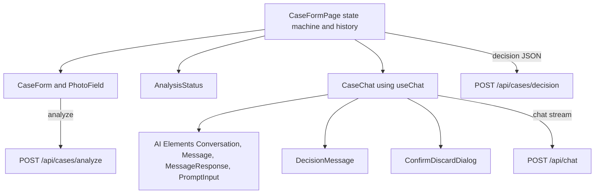
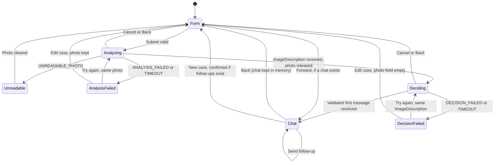
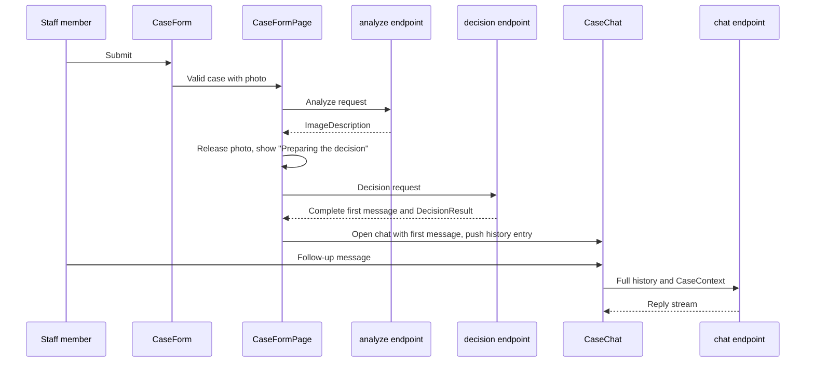
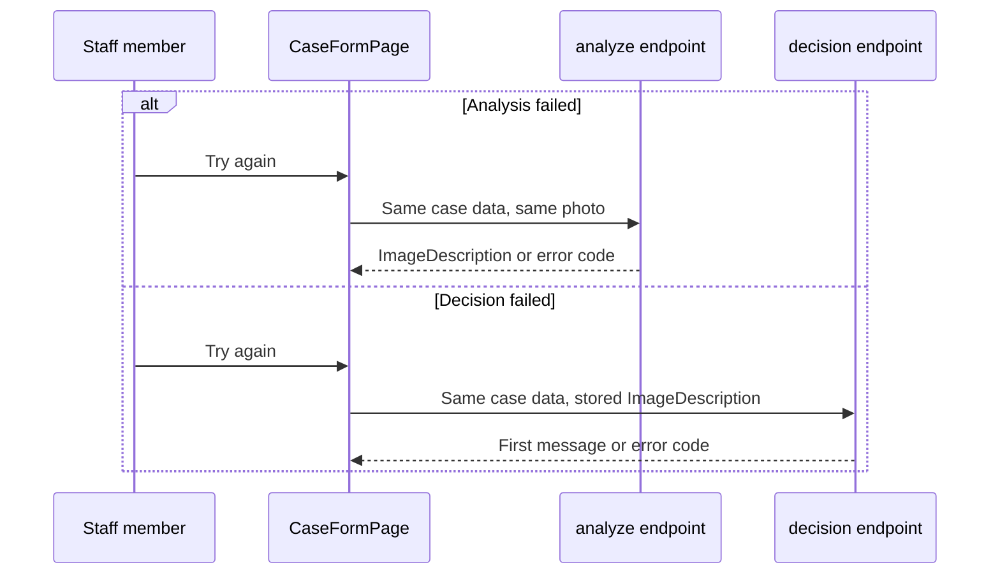

# ADR-004: Frontend and Chat UI

**Date:** 2026-10-21 (revised 2026-10-21, see Revision log)
**Status:** Accepted
**Relates to:** `docs/ADR/000-main-architecture.md`, `docs/ADR/002-ai-analysis-and-decision.md`, `docs/ADR/005-starter-template.md`

---

## 1. Scope

The browser side: the case form, the loading and error states, the chat screen, the session state, browser history handling, and how the decision flow (form → analysis → decision → chat) maps to screens and components. It also covers the chat UI components and how they connect to the routes in ADR-003 and to `useChat`. It does not cover prompts (ADR-002) or route internals (ADR-003).

---

## 2. Technology Documentation References

| Library | Context7 ID or official docs | Used for |
|---|---|---|
| AI SDK UI (`@ai-sdk/react` 4.0.16) | `/vercel/ai` (cookbook: `useChat` with a route handler) | `useChat`, `DefaultChatTransport`, `prepareSendMessagesRequest`, message parts, message metadata |
| Next.js 16.2.10 client components | `/vercel/next.js` | `'use client'` components and the App Router layout in `app/app/` |
| AI Elements | https://elements.ai-sdk.dev/llms.txt; template copy in `app/components/ai-elements/` | `Conversation`, `ConversationContent`, `Message`, `MessageContent`, `MessageResponse` (streaming markdown), `PromptInput` and its parts |
| shadcn/ui | https://ui.shadcn.com (template `components.json`) | Primitives that AI Elements is built on |
| assistant-ui (evaluated) | https://www.assistant-ui.com/docs/integrations/frameworks/ai-sdk | Alternative chat UI |
| Tailwind CSS 4 | From the template (ADR-005) | Styling with tokens from `docs/design-guidelines.md` |
| Vitest and Testing Library | https://vitest.dev, https://testing-library.com (to be added, ADR-005 section 7) | Component and state tests |
| Playwright | https://playwright.dev | E2E and Manual QA |

---

## 3. Component Design

### Screens

The app has one page (`/`) whose view is driven by a client state machine (section 7.2). Reloading the page resets to the form (AC-31).

1. **Form:** case form (PRD section 9.1).
2. **Analyzing:** the form is read-only, progress text "Analysing the photo…", Submit replaced by a disabled "Processing…" label, Cancel available (PRD section 9.2).
3. **Deciding:** same layout with "Preparing the decision…". The decision is not shown until the validated response arrives (ADR-002 section 3, PRD section 4.5).
4. **Analysis failed:** message above the form with "Try again" and "Edit case" (PRD section 9.3). The photo is still held, so Try again repeats the analysis with the same data and photo.
5. **Decision failed:** same message and controls. Try again repeats only the decision request, reusing the stored ImageDescription; no new analysis and no photo are needed.
6. **Unreadable photo:** message below the photo field; photo cleared (PRD section 9.4).
7. **Chat:** chat screen (PRD section 9.5), header with case type, category and model name, and "New case".

Revised 2026-10-21 (finding P2-7): the earlier single "Failed" state merged analysis and decision failures, so a retry could not repeat only the failed step as PRD section 4.5 requires.

### Photo lifetime in the browser

The photo `File` is held in state from selection until the analysis succeeds, so analysis retries and Cancel during analysis keep it. When the ImageDescription arrives the photo and its thumbnail are released (AC-35, strict reading: nothing is kept after the analysis step completes). Consequences:
- Decision failed → Try again needs no photo.
- Decision failed → Edit case, or Cancel during Deciding: the form returns with all text entries kept and the photo field empty; a new photo is needed because a new submit runs the analysis again. The PRD section 9.3 wording "all entries remain" is clarified in the PRD revision log. Keeping the photo until the chat opens is the alternative, listed for the user (OI-004-3).

### Browser history (Back button)

Revised 2026-10-21 (finding P2-7). One route with in-memory state alone means Back leaves the app. Decision:
- When the chat opens, the client pushes one history entry with the same URL. The history state holds only a step marker (`form` or `chat`), never case data, and nothing is added to the URL.
- Back from the chat restores the form view with entries kept (photo field empty, see above). Forward returns to the chat, which stays in memory until reload or "New case" (PRD section 9.5).
- Submitting the form again from that view starts a new case. If the existing chat has at least one follow-up message, the AC-32 confirmation is shown first.
- Loading and failure states push no entries. Back during Analyzing or Deciding behaves like Cancel.
- On page load the client replaces the history state with `form`, so a reload never restores the chat (AC-31).
- The PRD section 9.5 wording does not conflict, so the PRD is unchanged on this point.

### Components

| Component | Responsibility | Source | Notes |
|---|---|---|---|
| `CaseFormPage` | Owns the session state machine and the history handling | Own code | Client component |
| `CaseForm` | Fields, validation messages, Submit enablement, photo selection | Own code, shadcn/ui primitives | Field rules from the shared schema; "today" computed in `Europe/Warsaw` (AC-04) |
| `PhotoField` | Drop area, thumbnail, file name, Remove; rejects other file types and sizes before upload | Own code | Client component |
| `AnalysisStatus` | Loading texts and failure messages | Own code | Polish text from the message-key module |
| `CaseChat` | Chat list, input, Send, retry, timestamps, "New case" with confirmation | Own code around AI Elements | Uses `useChat` |
| AI Elements `Conversation`, `ConversationContent`, `Message`, `MessageContent`, `MessageResponse`, `PromptInput`, `PromptInputTextarea`, `PromptInputSubmit` | Message list, markdown rendering, text input | `app/components/ai-elements/` (template) | Names checked in the template on 2026-10-21. Attachment controls of `PromptInput` are not used (text only, AC-24) |
| `DecisionMessage` | Renders a decision message (first or revised): the composed text with `MessageResponse` | Own code | The first one is pinned as the first item and not removable (PRD section 9.5) |
| `ConfirmDiscardDialog` | "Discard this chat? The decision cannot be recovered." with Cancel and confirm | shadcn/ui Dialog | Shown only with at least one follow-up message (AC-32) |

### Session state

The state lives in React state inside `CaseFormPage`. It is not stored in localStorage or sessionStorage, because AC-31 requires that a reload ends the session. Fields held in state:

- CaseForm values (photo only until the analysis succeeds)
- ImageDescription from the analysis
- The first DecisionResult and the latest revised DecisionResult (for CaseContext)
- The chat message list owned by `useChat`
- Session status: one of the seven screens above

### Transport for chat (rework of the template hook)

The template's `app/hooks/use-active-chat.tsx` sends only the last message plus `selectedChatModel` and `selectedVisibilityType` in `prepareSendMessagesRequest`, because its route loads history from a database. For this app the request body carries the full `messages` array and CaseContext, and nothing else (AC-27, ADR-003 section 3). The template hook is replaced, not patched (ADR-005).

---

## 4. Data Structures

The browser uses the same shared schemas as the server (ADR-000 section 5).

- The first decision message is a UI message with role `assistant`, holding a text part (the composed message) and a data part with the validated DecisionResult. It is inserted into the `useChat` message list when the decision response arrives. The `system` role is not used.
- Follow-up messages use `text` parts only. A revised decision arrives in the reply stream as a text part plus a data part (ADR-002 section 3).
- Timestamps (AC-29): set by the client when a message is added (user message on send, assistant message on first part received) and shown in `Europe/Warsaw` local time. AI SDK message metadata is the preferred carrier if it fits the installed version; otherwise a client-side map from message id to timestamp. Not sent to the model.

---

## 5. Interface Contracts

| Interaction | Endpoint or component event | Client behaviour on success | Client behaviour on failure |
|---|---|---|---|
| Submit form | `POST /api/cases/analyze` | Store ImageDescription, release the photo, go to Deciding | `UNREADABLE_PHOTO`: Unreadable state, photo cleared. Other codes: Analysis failed, photo kept |
| Decision | `POST /api/cases/decision` (JSON) | Insert the complete first message, open Chat, push history entry | Decision failed; Try again repeats this request only |
| Send chat message | `POST /api/chat` via `useChat` | Append reply | "The reply failed. Try again" under the user message with Retry (AC-25) |
| Retry chat | Resend the last user message via `useChat` | Append reply | Same failure state |
| New case | Local state change | Reset to empty form | If at least one follow-up exists, show confirmation first (AC-32) |
| Cancel loading | Abort the active request | Return to form with entries kept (photo kept only during Analyzing) | Not applicable |

Timeouts: the client aborts any single request after 30 seconds and shows the matching failure (ADR-000 section 6). The same abort mechanism serves Cancel. A late response after abort is ignored.

---

## 6. Component and Flow Mapping

| Step | Screen | Component | Endpoint | Outcome |
|---|---|---|---|---|
| Formularz (form) | Form | `CaseForm`, `PhotoField` | none (local validation) | Valid submit |
| Analiza zdjęcia (photo analysis) | Analyzing | `AnalysisStatus` | `POST /api/cases/analyze` | ImageDescription, unreadable photo or analysis failure |
| Decyzja (decision) | Deciding, then Chat | `AnalysisStatus`, then `DecisionMessage` | `POST /api/cases/decision` | Complete first message or decision failure |
| Chat | Chat | `CaseChat` | `POST /api/chat` | Follow-up replies and revised decisions |

Note on terms: the brief uses Polish step names. In the UI all text is Polish (AC-33, PRD section 13). In code and ADRs the step names are English.

---

## 7. Diagrams

### 7.1 Component diagram

### 7.2 Screen state diagram

### 7.3 Flow sequence from submit to chat

### 7.4 Retry sequences

---

## 8. Testing Strategy

### Test layers for this area

Revised 2026-10-21 (finding P2-1). AGENTS.md allows integration tests to mock only the external LLM API. Browser tests that stub the app's own `/api` routes are therefore unit (component) tests, not integration tests.

- **Unit (Vitest with Testing Library, jsdom; all dependencies mocked, including `fetch` to the app's own routes):** field validation messages and enablement, Submit disabled while processing (AC-08), Polish text for each message key (AC-33), character counters, state machine transitions including the split failure states, photo release on analysis success, history push and popstate handling, the confirmation dialog rule (AC-32), rendering a decision response into the first message, failure codes mapped to the right messages, chat reply failure and Retry.
- **Integration:** none in the browser layer. Route integration tests live in ADR-002 and ADR-003.
- **E2E (Playwright, no mocks, real stack and real OpenRouter key):** the flows below. Failure paths are forced without mocking anything:
  - Unreadable photo: a real blank or very dark synthetic image; the real model returns `photoUsable` = no.
  - Analysis or decision failure and retry: the Playwright browser context is switched offline before the request and back online before Try again. The real app and real routes run; only the network is cut.
  - Server-side provider failure: a separate Playwright project starts the app with an invalid `OPENROUTER_API_KEY`, so the real provider rejects the call and the real failure message appears.
  - Timeout: not forced in E2E (it would need a slow model). Covered by fake-clock unit and integration tests; the 30-second abort is checked in Manual QA only if a slow response occurs naturally.
- **Manual QA (AGENTS.md):** screenshots of each touched screen; comparison with `assets/homepage.png` and `docs/design-guidelines.md` tokens; viewport checks at 360 px and 1440 px (AC-34); console error check; Back and Forward behaviour; Edge on mobile (not covered by Playwright).

### Browser matrix (PRD section 8)

Follow-up for code: `app/playwright.config.ts` has only a Desktop Chrome project. Add projects for Desktop Firefox, Desktop Safari (WebKit), Desktop Edge (`msedge` channel), Mobile Chrome and Mobile Safari. Edge on mobile is covered by Manual QA.

### Test scenarios

| Scenario | Type | Input | Expected output | Edge cases |
|---|---|---|---|---|
| Complaint happy path | E2E | Complaint form with a clear synthetic photo | "Analysing the photo…", then "Preparing the decision…", then chat with the complete first message: greeting, bold category in sentence two, rules, next steps, disclaimer | No decision text visible before the chat opens; timestamp on each message (AC-29) |
| Return happy path | E2E | Return form, reason empty | Chat with return decision, return rules referenced | Reason optional (AC-06) |
| Unreadable photo | E2E | Blank synthetic image | Message below photo field; photo cleared; no chat | Entries kept (section 4.3) |
| Analysis failure and retry | E2E | Offline during analysis, online for Try again | Failure message, photo kept, Try again leads to chat | Entries kept |
| Decision failure and retry | E2E and unit | Offline during decision, online for Try again | Failure message; Try again calls only the decision route | No second analyze request (network log) |
| Provider failure | E2E (invalid-key project) | Valid form | Failure message from PRD section 4.5 | No English or provider text shown |
| Cancel during loading | Unit | Cancel during Analyzing and during Deciding | Returns to form, entries kept, request aborted | Late response ignored; photo empty after Deciding |
| Follow-up | E2E | Send a question | Reply appears with timestamp | Empty input cannot be sent (AC-24) |
| Reply failure and retry | Unit | Stubbed chat fetch error | Failure text under user message, Retry sends the same message | Pending reply disables Send |
| New case with follow-ups | E2E | Click New case after a follow-up | Confirmation dialog; Cancel keeps chat; confirm returns to empty form | With no follow-ups, no dialog |
| Back and Forward | E2E | Back from chat, then Forward | Form with entries kept, then the same chat | Back during loading acts as Cancel |
| Reload | E2E | Reload during chat | Empty form, no data restored (AC-31) | History state reset to form |
| Viewport | E2E | 360 px and 1440 px | No horizontal scrolling (AC-34) | Chat input stays visible |
| Polish text | E2E and unit | All screens | Every string matches PRD section 13; no English UI text (AC-33) | AI Elements default English labels overridden |

### Technical acceptance criteria

- **TAC-004-01:** Submit is disabled while a request is in progress (AC-08), tested in unit tests.
- **TAC-004-02:** The photo is released from client state when the analysis succeeds (AC-35), tested by a unit test on the state transition and by a manual check in the browser.
- **TAC-004-03:** No client code writes to localStorage or sessionStorage for session data, and the history state carries only a step marker (AC-31), verified by a grep check, a unit test and an E2E reload test.
- **TAC-004-04:** The first decision message is the first item in the chat list and cannot be removed (PRD section 9.5), tested in unit and E2E tests.
- **TAC-004-05:** Every touched screen has a screenshot in the Manual QA report, compared with the brand reference.
- **TAC-004-06:** No console errors during the E2E flows.
- **TAC-004-07:** A decision retry never re-sends the analyze request (unit test and E2E network log).
- **TAC-004-08:** No decision text is rendered before the validated decision response arrives (unit test; E2E check during Deciding).

---

## 9. Technical Decisions

### Chat UI: AI Elements on shadcn/ui
**Status:** Accepted
**Date:** 2026-10-21
**Context:** The chat needs streaming markdown, a message list, an input, timestamps and a first message layout. The UI must work with `useChat` and match the design guidelines.
**Decision:** Use the AI Elements components shipped with the template in `app/components/ai-elements/`. `MessageResponse` (exported from `message.tsx`) renders markdown. Own components wrap them for the decision message, timestamps, the analysis summary and the discard dialog.
**Rejected alternatives:**
- assistant-ui: adds a runtime layer over `useChat` and a package matrix that changes across versions. Kept as a fallback if AI Elements lacks a needed behaviour.
- Building all components from scratch: more work for streaming markdown and scroll behaviour that AI Elements already covers.
- chat-sdk.dev: a bot SDK with a different purpose (ADR-000 section 12).
**Consequences:**
- (+) Components are local source files, which makes the Polish text and the design tokens easy to set.
- (-) Default English labels must be overridden in every component used (AC-33).
**Review trigger:** AI Elements cannot provide a required behaviour, such as first-message pinning or timestamps, without large changes.

### Client state in React, not in browser storage
**Status:** Accepted
**Date:** 2026-10-21
**Context:** AC-31 requires that a reload ends the session.
**Decision:** Keep the session in React state. `useChat` holds the message list in memory.
**Rejected alternatives:**
- sessionStorage: survives reloads in the same tab, which AC-31 forbids.
- localStorage: survives reloads and browser restarts.
**Consequences:**
- (+) Matches AC-31 directly.
- (-) An accidental reload loses the case; the PRD accepts this.
**Review trigger:** The PRD adds session persistence.

### One page with a state machine and one history entry per step
**Status:** Accepted
**Date:** 2026-10-21
**Context:** The flow has seven view states (section 7.2). PRD section 9.5 requires Back from the chat to return to the form with entries kept.
**Decision:** One client page with a state machine. The chat step pushes a history entry with a step marker only; `popstate` switches the view. No separate routes and no data in the URL.
**Rejected alternatives:**
- Separate routes for form and chat: navigation would need to carry the session state, which the PRD forbids storing.
- No history entries: Back would leave the app, contradicting PRD section 9.5.
**Consequences:**
- (+) Back and Forward work without storing data.
- (-) History handling is own code and needs unit and E2E tests.
**Review trigger:** A second screen with independent state is added.

### Separate failure states for analysis and decision
**Status:** Accepted
**Date:** 2026-10-21
**Context:** PRD section 4.5 says Try again repeats the failed step with the same data.
**Decision:** Two failure states. Analysis failure keeps the photo and repeats the analysis. Decision failure reuses the stored ImageDescription and repeats only the decision.
**Rejected alternatives:**
- One failure state that always restarts from the analysis: repeats a step that succeeded and needs the photo after it should be released.
**Consequences:**
- (+) Cheaper retries; AC-35 respected.
- (-) Edit case after a decision failure needs a new photo (OI-004-3).
**Review trigger:** The user prefers keeping the photo until the chat opens.

### Polish UI text in one module, English identifiers
**Status:** Accepted
**Date:** 2026-10-21
**Context:** AC-33 requires Polish UI text. PRD section 13 now lists the exact strings.
**Decision:** UI strings are Polish and live in one module of message keys whose values come from PRD section 13. Identifiers and comments are English.
**Rejected alternatives:**
- Inline Polish strings in each component: hard to check for AC-33 completeness.
**Consequences:**
- (+) One place to check for English leftovers; a unit test compares keys with the PRD table.
- (-) An extra indirection for strings.
**Review trigger:** A second language is added.

### Analysis summary: not in the MVP
**Status:** Accepted 2026-10-21 (closes OI-004-2)
**Date:** 2026-10-21
**Context:** PRD persona 2 wants to see how the system read the photo; PRD section 12 assumes a summary in the first message only.
**Decision:** No separate analysis panel in the MVP. The summary stays in the first decision message, as PRD section 12 assumes. A read-only panel (the former proposal) is deferred until technicians ask for it after the first use.
**Rejected alternatives:**
- Read-only "Analysis of the photo" panel now: one more component and one more UI change to the PRD, with no evidence yet that technicians need it.
**Consequences:**
- (+) Smaller MVP; no extra PRD UI change.
- (-) Technicians cannot check the photo reading separately from the decision text until the panel is added later.
**Review trigger:** Technicians report that they cannot verify the reading from the first message.

---

## 10. Open Items

- **OI-004-1** Closed 2026-10-21: AI Elements names checked in the template. `message.tsx` exports `Message`, `MessageContent`, `MessageResponse` and others; there is no `Response` export.
- **OI-004-2** Closed 2026-10-21: no analysis panel in the MVP (section 9).
- **OI-004-3** Closed 2026-10-21: the photo is released when the analysis succeeds. Edit case after a decision failure therefore needs a new photo (PRD section 9.3 wording applies).
- The former items on replacing a streamed decision with ESCALATE and on the Back behaviour are closed: the decision is no longer streamed (ADR-002 section 3), and Back is defined in section 3.

---

## Revision log

- **2026-10-21** Documentation review:
  - P1-1: Deciding state shows only the loading text; the first message is inserted complete; replacement design item closed.
  - P2-1: stubbed-route browser tests reclassified as unit tests; E2E failure paths forced with offline network and an invalid-key project; timeout left to fake-clock tests.
  - P2-2: template transport (`app/hooks/use-active-chat.tsx`) replaced by full messages plus CaseContext.
  - P2-7: failure states split; photo lifetime defined; history entry per step with no data in the URL.
  - P3: assistant role with text and data parts; `Europe/Warsaw` for dates and timestamps; browser matrix follow-up; analysis summary panel proposed.
  - P4: `Response` replaced by `MessageResponse`; ADR-001 reference replaced by ADR-005; message metadata option for timestamps; open items renumbered to OI-004-n.
