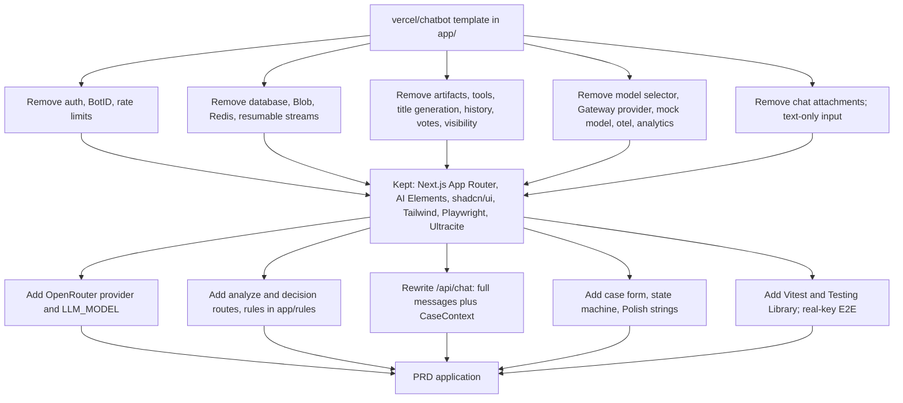

# ADR-005: Starter Template for the Chat Application

**Date:** 2026-10-21 (revised 2026-10-21, see Revision log)
**Status:** Accepted. Template installed in `app/` (untracked); rework for the PRD pending (section 7)
**Supersedes:** the scaffold decision in `docs/ADR/001-project-initialization.md`
**Relates to:** `docs/ADR/000-main-architecture.md`, `docs/ADR/002-ai-analysis-and-decision.md`, `docs/ADR/003-backend-api.md`, `docs/ADR/004-frontend-chat-ui.md`

---

## 1. Scope

Which existing template the application starts from, instead of Create Next App. It covers the candidates checked, the choice, the installed state and its verification results, what must be removed or replaced to meet the PRD, the testing setup the template needs, and the follow-up work. It does not cover the decision flow itself (ADR-002 to ADR-004).

Why a template: the user asked for a starter that already connects Next.js, the Vercel AI SDK and a chat UI, so the chat framework exists on day one.

---

## 2. Technology Documentation References

| Library | Source | Used for |
|---|---|---|
| Chatbot template (`vercel/chatbot`, formerly AI Chatbot) | https://github.com/vercel/ai-chatbot (redirects to `vercel/chatbot`); inspected clone at commit `c2f8235e1f3ea903ad8b7f61447c4f74164b5c58` (2026-07-08) | Starter application |
| Chat SDK | https://chat-sdk.dev and the `vercel/chat` repository (example `nextjs-chat`) | Evaluated; optional layer, see section 4 |
| Vercel AI SDK (`ai` 7.0.15, `@ai-sdk/react` 4.0.16) | Context7 `/vercel/ai` | Chat route and UI hooks |
| Next.js 16.2.10 | Context7 `/vercel/next.js` | App Router, route handlers, output file tracing |
| `@openrouter/ai-sdk-provider` | npm: version 3.1.0, peer dependency `ai` `^7.0.0` (checked 2026-10-21); not installed yet | Replaces the template's AI Gateway provider |
| OpenRouter AI SDK example | `OpenRouterTeam/openrouter-examples`, folder `typescript/ai-sdk-v5` | Reference only; pins `ai` 5.0.108 and provider 1.5.3, too old for this stack |
| Ultracite (Biome) | `ultracite` ^7.8.4, `@biomejs/biome` 2.5.2 in `app/package.json` | Lint and format |
| Playwright | `@playwright/test` ^1.61.1 in `app/package.json` | E2E |

---

## 3. Candidates Checked

Each candidate was cloned or read on 2026-10-21 (shallow clones outside the project).

| Candidate | Stack found | Fit for the PRD | Verdict |
|---|---|---|---|
| **`vercel/chatbot`** | Next.js 16.2.10 App Router; `ai` 7.0.15; `@ai-sdk/react` 4.0.16; pnpm 10.32.1. `components/ai-elements/` (conversation, message, prompt-input, reasoning, tool, code-block, model-selector, shimmer, suggestion). Chat route uses `convertToModelMessages`, `createUIMessageStream` and `streamText`. Playwright tests. Model access through the Vercel AI Gateway. | Strong base for streaming and AI Elements. Needs removal of auth, database, storage and the other features listed in section 4. | **Selected** |
| `vercel/chat`, example `examples/nextjs-chat` | Chat SDK with `@chat-adapter/web/react`; Next.js 16.3.8, `ai` 7.0.0, `@ai-sdk/react` 4.0.0; multi-platform bot server with Redis state | Purpose is a bot across chat platforms, which the PRD does not need | Optional layer later |
| `vercel-labs/ai-sdk-preview-attachments` | Next 14.2.5, `ai` 4.x, Tailwind 3 | Two major releases behind | Rejected (too old) |
| `OpenRouterTeam/openrouter-examples/typescript/ai-sdk-v5` | `ai` 5.0.108, provider 1.5.3; plain TypeScript | Confirms OpenRouter usage pattern only | Reference, not a base |
| Create Next App | Bare page | No chat framework | Rejected (user request) |

---

## 4. Decision

**Start from `vercel/chatbot`.** It already has the streaming route, the `useChat`-based UI and the AI Elements components that ADR-004 uses, so the work is reworking it for the PRD.

The Chat SDK is not installed now: the PRD has no chat platforms or integrations (PRD section 7). Its web adapter speaks the same AI SDK stream protocol and can be added later (OI-005-1).

### Changes the template needs for this PRD

| Area | Template today (verified in `app/`) | Required for the PRD |
|---|---|---|
| Model provider | Vercel AI Gateway in `app/lib/ai/providers.ts`; model list and `DEFAULT_CHAT_MODEL` in `app/lib/ai/models.ts` | `@openrouter/ai-sdk-provider` 3.1.0 in one `llm-client` module, one model from `LLM_MODEL` (ADR-000, ADR-002). Gateway order options, capability fetch and model availability checks removed. |
| Model selector | `components/ai-elements/model-selector.tsx`, `app/(chat)/api/models`, `selectedChatModel` in requests | Removed. One model only. |
| Test mock model | `isTestEnvironment` in `app/lib/constants.ts` (true when `PLAYWRIGHT`, `PLAYWRIGHT_TEST_BASE_URL` or `CI_PLAYWRIGHT` is set); `app/lib/ai/models.mock.ts` and `app/lib/ai/models.test.ts` (mock model modules, not tests); the `test` script sets `PLAYWRIGHT=True` | Removed for this app (finding P1-3). The provider never switches to a mock model at runtime. E2E runs with the real `OPENROUTER_API_KEY` (AGENTS.md: E2E mocks nothing). Integration tests replace the provider boundary inside the test process only, from captured responses (ADR-002 section 9). |
| Authentication | Auth.js, `AUTH_SECRET`, `app/(auth)` routes, `proxy.ts`, guest users, entitlements | Removed. The PRD has no login (section 7). |
| Bot protection | BotID (`botid`), `withBotId` in `next.config.ts`, `initBotId` in `instrumentation-client.ts`, `checkBotId` in the chat route | Removed. Not required by the PRD. |
| Rate limiting | Redis IP rate limit (`lib/ratelimit.ts`) and per-user message limits | Removed (ADR-003 section 5). |
| Database | Postgres via Drizzle, `POSTGRES_URL`, `db:*` scripts, `tsx lib/db/migrate` in the `build` script | Removed. The PRD forbids persistence (AC-31, section 7). The `build` script becomes `next build`. |
| File storage | Vercel Blob, `app/(chat)/api/files` | Removed. The photo is not stored (AC-35). |
| Redis and resumable streams | `REDIS_URL`, `resumable-stream`, `app/(chat)/api/chat/[id]` stream resume | Removed. |
| Chat history and sharing | History API, sidebar history, votes, visibility selector, chat pages under `app/(chat)/chat/[id]` | Replaced by in-memory session state (ADR-004). |
| Artifacts and tools | `app/artifacts/`, `lib/ai/tools/` (create, edit and update document, weather, suggestions), `app/(chat)/api/document`, `api/suggestions`, artifact and editor components (CodeMirror, ProseMirror, data grid) | Removed. The only tool is `reviseDecision` (ADR-002 section 3). |
| Title generation and request hints | `generateTitleFromUserMessage`, geolocation hints | Removed. |
| Telemetry and analytics | `@vercel/otel` and `@ai-sdk/otel` in `instrumentation.ts`, `@vercel/analytics` dependency | Removed for the MVP (no requirement; data leaves the app). |
| Chat input attachments | `multimodal-input.tsx`, attachment parts of `PromptInput`, file parts in the chat request schema | Removed. Chat input is text only, 1 to 2000 characters (AC-24). The photo is uploaded only through the case form. |
| Chat route | `app/app/(chat)/api/chat/route.ts`: receives only the last message (`prepareSendMessagesRequest` in `app/hooks/use-active-chat.tsx`), loads history from the database, requires auth and BotID, applies rate limits, reads `selectedChatModel` and `selectedVisibilityType` | Kept as the file for `/api/chat`, rewritten (finding P2-2): the client sends the full `messages` array plus CaseContext; the route validates them and keeps no state; database, auth, BotID, rate limits, model selection and visibility handling are removed. `maxDuration = 60` stays (OI-000-6). New routes `/api/cases/analyze` and `/api/cases/decision` are added (ADR-003). |
| UI | AI Elements, shadcn/ui, Tailwind 4 | Kept. Polish text from PRD section 13 and the design tokens replace the defaults (AC-33). |
| Environment file | `app/.env.example` listed Gateway, Auth, Blob, Postgres and Redis keys | Rewritten 2026-10-21: only `OPENROUTER_API_KEY` and `LLM_MODEL`, empty; template keys commented out until the code that reads them is deleted (finding P2-4). |
| Package manager | pnpm 10.32.1 (`packageManager` field) | Kept. ADR-001 (npm) is superseded. |
| Lint and format | Ultracite (Biome): `pnpm check`, `pnpm fix`; husky and lint-staged | Kept. Not ESLint. |
| Tests | Playwright only (`tests/e2e/*.test.ts`, project `e2e`, Desktop Chrome); no Vitest, no Testing Library | Playwright kept; template specs (auth, model selector, chat, api) replaced by PRD specs. Vitest and Testing Library added (finding P2-3, section 6). |

### Path and layout

The template's project root is `app/`, so the App Router directory is `app/app/`. The course `app/README.md` stays; the template README is `app/TEMPLATE_README.md`. Rule documents are copied into `app/rules/` (ADR-002 section 6).

### Installation rules

1. Copy the template without its `.git` directory and without overwriting `app/README.md`.
2. Install with `pnpm install --ignore-scripts`. The `prepare` script runs `husky`, which would change git hook settings for the parent repository.
3. Create `app/.env.local` from `app/.env.example` with only `OPENROUTER_API_KEY` and `LLM_MODEL`. It is git-ignored by `app/.gitignore` and the root `.gitignore`.
4. Record the template commit used (section 2).

---

## 5. Consequences

- (+) A streaming chat with AI Elements exists on day one; rework is focused on the PRD.
- (+) Current versions: AI SDK 7 with `@ai-sdk/react` 4, matching `@openrouter/ai-sdk-provider` 3.1.0.
- (-) The template ships much that must be removed (section 4). This is the main cost, and the template build and tests depend on external services until it is done.
- (-) The template uses pnpm and Ultracite, not npm and ESLint as ADR-001 assumed.

---

## 6. Installation Status and Verification

**Installed.** The template from `vercel/chatbot` (commit in section 2) is in `app/`, untracked in git, with `node_modules` present. `app/README.md` is the course file; the template README is `app/TEMPLATE_README.md`. The earlier note that the copy was blocked is obsolete.

Verification results reported for the unmodified template (2026-10-21). Each check is recorded separately:

| Check | Command | Result |
|---|---|---|
| Type check | `pnpm exec tsc --noEmit` | Passed |
| Lint | `ultracite check` | Passed on 132 files |
| Build (compilation) | `pnpm exec next build` (not `pnpm build`, which runs database migrations) | Compiled successfully and finished TypeScript; no error or warning lines in the log at `~/.cache/template-research/build.log` |
| Startup | `pnpm dev` | **Not run.** Startup is unverified. It needs `app/.env.local`; the unmodified template also expects Postgres, Auth and Gateway keys. |
| Tests | `pnpm test` | Not run. The script enables the mock model (section 4) and is replaced in the rework. |

The type check and lint results were reported by the earlier research session; this review confirmed the build log contents only.

---

## 7. Testing Strategy for the Template Rework

### Setup (follow-up for code work)

- Add Vitest, `@testing-library/react`, `@testing-library/user-event` and a jsdom environment as dev dependencies (verify current versions with Context7 before installing).
- Separate the runners by path so neither picks up the other's files:
  - Vitest includes `tests/unit/**/*.test.{ts,tsx}` and `tests/integration/**/*.test.ts`, and excludes `tests/e2e/**` and `node_modules/**`.
  - Playwright keeps `testDir: ./tests` with `testMatch` limited to `e2e/*.test.ts` (as today), plus an agent-behaviour project kept out of the default run.
  - Delete `app/lib/ai/models.test.ts` with the mock model, so no `*.test.ts` outside `tests/` remains.
- Scripts: `test:unit`, `test:integration`, `test:e2e`. Remove `PLAYWRIGHT=True` from the test script and `isTestEnvironment` from the provider path.
- Playwright projects for the PRD browser matrix (ADR-004 section 8) and an invalid-key project for failure paths.

### Test scenarios

| Scenario | Type | Input | Expected output | Edge cases |
|---|---|---|---|---|
| No mock model at runtime | Unit | Provider factory with `PLAYWRIGHT` set | Still returns the OpenRouter provider for `LLM_MODEL` | `CI_PLAYWRIGHT` set |
| Runner separation | Verification | `test:unit` and `test:e2e` | Each reports its own discovery count; no Playwright spec runs under Vitest | Empty suites report zero, not an error |
| Removed features | Verification | Grep for `next-auth`, `drizzle`, `@vercel/blob`, `redis`, `botid`, `gateway`, `@vercel/otel` imports | None after the rework | `package.json` dependencies removed too |
| Chat request shape | Unit | Hook transport | Body has full `messages` and CaseContext only | No `selectedChatModel` or `selectedVisibilityType` |
| Build without services | Verification | `pnpm build` with only the two course keys | Build succeeds | No migration step |
| Startup | Verification | `pnpm dev`, open `/` | Form renders; recorded separately from build and tests | Missing key shows a server error, not a crash loop |
| Env file | Verification | `app/.env.example` | Only `OPENROUTER_API_KEY` and `LLM_MODEL` active | `app/.env.local` ignored by git |

### Technical acceptance criteria

- **TAC-005-01:** No code path selects a mock language model at runtime; E2E uses the real OpenRouter key.
- **TAC-005-02:** Vitest and Playwright discover disjoint file sets.
- **TAC-005-03:** `pnpm build` succeeds without Postgres, Redis, Blob or Auth configuration.
- **TAC-005-04:** Build, tests and startup are each run and recorded separately.

---

## 8. Diagrams

### 8.1 Migration from the template to the PRD app

---

## 9. Open Items

- **OI-005-1** Closed 2026-10-21: Chat SDK is added later, if at all (section 4).
- **OI-005-2** Run and record the startup check (`pnpm dev`) once `app/.env.local` exists.
- **OI-005-3** Confirm the model for `LLM_MODEL` on OpenRouter (OI-000-3). The template's model list is not reused.
- **OI-005-4** Decide when to commit the template into git (it is untracked); the course commit rules apply.
- The former items on approving installation and on running Postgres for the build are closed: the template is installed, and the migration step is removed from the build script in the rework.

---

## Revision log

- **2026-10-21** Documentation review:
  - P1-3: mock-model path (`isTestEnvironment`, `models.mock.ts`, `PLAYWRIGHT=True`) removed for this app; E2E uses the real key.
  - P2-2: chat route rework recorded with the real path and the template transport.
  - P2-3: "Vitest-style tests" corrected; Vitest and Testing Library are follow-ups with path-separated include patterns.
  - P2-4: `app/.env.example` reduced to the course keys.
  - P4: removal list extended (artifacts, tools, model selector, BotID, Redis rate limiting, analytics, otel, chat attachments); installation status updated with template commit and separate build, lint, type check and startup results; Mermaid diagram and testing section added; open items renumbered to OI-005-n.
